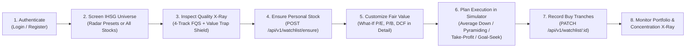
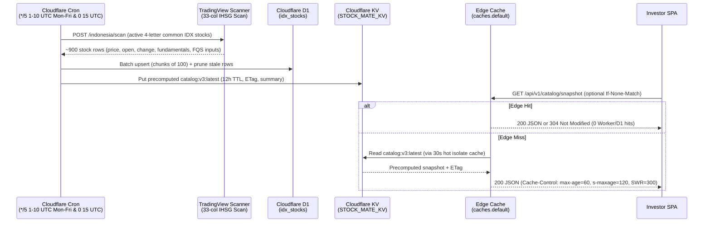
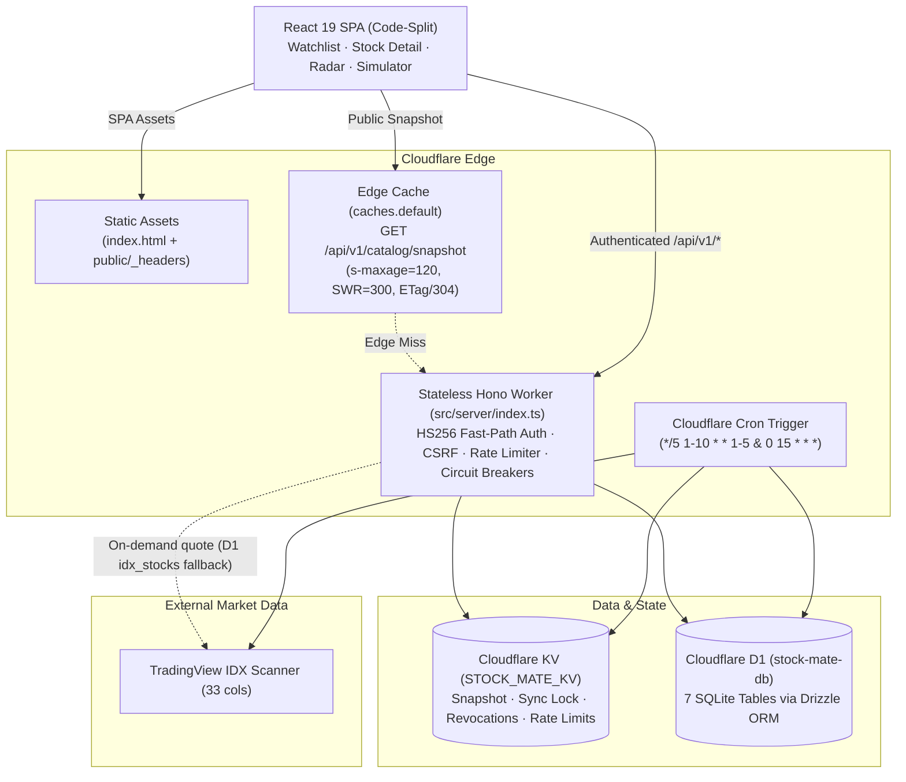

# Stock-Mate v2

> **IDX / BEI Intrinsic Fair Value Valuation Engine, 4-Track Fundamental Quality Radar & Position-Linked Trade Simulator**  
> As-Built Product, Functional, Architectural, Security, and Operational Documentation for Indonesian Stock Exchange (**IDX / BEI**) retail equity investors.

- **Live Production App:** https://stock-mate-v2.charlymicolas21.workers.dev
- **Repository:** https://github.com/charlybutar21/stock-mate-v2
- **Runtime Platform:** Cloudflare Workers + Cloudflare D1 (SQLite) + Cloudflare KV + Static SPA Assets
- **Supporting Documentation:** [`docs/architecture.md`](docs/architecture.md) · [`docs/functional-specification.md`](docs/functional-specification.md) · [`docs/business-rules.md`](docs/business-rules.md) · [`docs/database-design.md`](docs/database-design.md) · [`docs/api-specification.md`](docs/api-specification.md) · [`docs/integration-guide.md`](docs/integration-guide.md) · [`docs/deployment-guide.md`](docs/deployment-guide.md) · [`docs/operational-runbook.md`](docs/operational-runbook.md) · [`docs/ADR-001-100k-scaling-architecture.md`](docs/ADR-001-100k-scaling-architecture.md)

---

## Table of Contents

1. [Product Overview](#1-product-overview)
2. [Product Objectives and Scope](#2-product-objectives-and-scope)
3. [Features and Capabilities](#3-features-and-capabilities)
4. [Functional Specifications](#4-functional-specifications)
5. [Business Logic and Business Rules](#5-business-logic-and-business-rules)
6. [End-to-End Business Process Flows](#6-end-to-end-business-process-flows)
7. [System Architecture](#7-system-architecture)
8. [Technology Stack](#8-technology-stack)
9. [Project Structure and Component Responsibilities](#9-project-structure-and-component-responsibilities)
10. [Database Design and Data Model](#10-database-design-and-data-model)
11. [API Specifications](#11-api-specifications)
12. [Internal and External System Integrations](#12-internal-and-external-system-integrations)
13. [Background Jobs, Schedulers, and Asynchronous Processing](#13-background-jobs-schedulers-and-asynchronous-processing)
14. [Authentication, Authorization, and Security](#14-authentication-authorization-and-security)
15. [Environment and Configuration Management](#15-environment-and-configuration-management)
16. [Prerequisites, Installation, and Local Development Setup](#16-prerequisites-installation-and-local-development-setup)
17. [Testing and Quality Assurance](#17-testing-and-quality-assurance)
18. [Build, CI/CD, and Deployment](#18-build-cicd-and-deployment)
19. [Monitoring, Logging, and Troubleshooting](#19-monitoring-logging-and-troubleshooting)
20. [Known Limitations and Technical Debt](#20-known-limitations-and-technical-debt)
21. [Maintenance and Service Ownership](#21-maintenance-and-service-ownership)
22. [References and Related Documentation](#22-references-and-related-documentation)

---

## 1. Product Overview

**Stock-Mate v2** is an edge-native equity research, portfolio tracking, and trade simulation web application tailored specifically for **Indonesia Stock Exchange (IDX / Bursa Efek Indonesia)** retail investors.

It combines an institutional-style **Core-3 Intrinsic Fair Value Engine** (Relative P/E, Relative P/B, and 5-Year Simple DCF), a **4-Track Fundamental Quality Score (FQS v2, graded S–E)** with an **IHSG Value Trap Shield**, a **Portfolio & Custom Watchlist Workspace** with concentration X-Ray analytics, and a **100% IDX-compliant Position Simulator** (official 5-bracket price ticks, 100-share lots, standard broker fees, and optional *Bea Materai* stamp duty).

The frontend adopts a compact, mobile-first Stockbit/Ajaib-inspired interface with full English (`EN`) and Bahasa Indonesia (`ID`) localization, Light/Dark themes, and privacy balance masking. The backend runs as a stateless **Hono** application on **Cloudflare Workers**, backed by **Cloudflare D1 (SQLite)** and **Cloudflare KV**, sharing an isomorphic TypeScript domain core (`src/shared/domain/`) with **100% enforced test coverage**.

> **Disclaimer:** Stock-Mate v2 is an educational and self-analysis tool only — not financial advice or a buy/sell stock recommendation.

---

## 2. Product Objectives and Scope

### Core Objectives
1. **Standardize IDX Fundamental Valuation:** Automate intrinsic fair value estimation across all active IHSG common stocks using transparent, sector-aware models without spreadsheets.
2. **Prevent Retail Value Traps:** Pair valuation discounts (Margin of Safety) with a strict 4-track institutional quality model (`FQS v2`) and explicit value-trap warnings (`CYCLICAL_PEAK_WARNING`, `SHRINKING_EARNINGS_TRAP`, `LOW_ROE_VALUE_TRAP`, `HIGH_LEVERAGE_TRAP`).
3. **Model Real Indonesian Execution Costs:** Account for IDX lot sizing (`1 lot = 100 shares`), exact 5-bracket tick rules, standard retail buy/sell fees (`0.15%` / `0.25%`), and optional `Rp 10,000` stamp duty (`> Rp 10,000,000`) across portfolio P&L and trade simulations.
4. **Deliver Fast, Resilient Edge Performance:** Serve ~900 active IHSG stocks with sub-200ms edge latency and graceful upstream fallbacks during IDX market open/close traffic spikes.

### As-Built Scope Boundaries

| In Scope (Implemented) | Out of Scope (Not Implemented in Current Codebase) |
| :--- | :--- |
| Email/password auth with `HttpOnly` dual-cookie sessions | OAuth/SSO, MFA, email verification, password reset flows |
| Personal portfolio holdings (up to 20 buy tranches per stock) & custom watchlists | Live brokerage order execution, RDN cash ledger, realized P&L/dividend cash history |
| Automated IHSG catalog sync (TradingView 33-col scanner + D1 `idx_stocks` fallback) | Real-time WebSocket Level-2 orderbook streaming or intraday tick charts |
| Core-3 Fair Value, 4-Track FQS v2, QARP screener, Value Trap Shield | Corporate action auto-adjustment (stock splits, rights issues, bonus shares) |
| Client-side IDX Trade Simulator (Average Down, Pyramiding, Take-Profit, Goal-Seek) | Saving/persisting simulator scenarios to the database |
| Bilingual UI (`EN`/`ID`), Light/Dark theme, Privacy Mask, Gross/Net P&L toggle | Multi-currency portfolios (strictly IDR / IDX equities) |

---

## 3. Features and Capabilities

### 3.1 Portfolio Workspace, All IHSG Screener & Custom Watchlists
- **Portfolio-First Landing (`/watchlist`):** Defaults to owned holdings (`ownedLots > 0`) with summary KPIs (Market Value, Invested Capital, Unrealized P/L in IDR & %), privacy masking (`Rp •••••••`), and a persisted **Broker Gross vs Net After Fees** mode switcher ([`WatchlistPage.tsx`](src/client/features/watchlist/WatchlistPage.tsx), [`useCalcMode.tsx`](src/client/lib/useCalcMode.tsx)).
- **Allocation Risk X-Ray:** Compact 1-line concentration status bar expanding into dual interactive SVG donut charts flagging single-stock concentration (`> 25%`) and sector concentration (`> 40%`) when holding ≥ 2 stocks ([`PortfolioRiskXrayCard.tsx`](src/client/features/watchlist/PortfolioRiskXrayCard.tsx)).
- **All IHSG Stocks Tab:** Paginated (`10 / 50 / 100` rows, default `10`) view of all active 4-letter IHSG common stocks with intraday `openPrice`, `dailyChange`, `dailyChangePct`, Fair Value Moderate, MoS %, FQS Grade, and Value Trap indicators.
- **Custom Watchlists:** Create up to **30** named lists with up to **100** tickers each, quick-add via live search autocomplete, or toggle membership from any stock row ([`custom-watchlist-use-cases.ts`](src/server/modules/watchlist/application/custom-watchlist-use-cases.ts)).

### 3.2 Stock Detail & Live What-If Valuation Workbench
- **Deep-Dive View (`/watchlist/:id`):** Displays market ratios (P/E, P/B, Dividend Yield, PEG), Core-3 Fair Value cards (Relative P/E, Relative P/B, 5-Year Simple DCF) with visual `Conservative / Moderate / Optimistic` range bar ([`FairValueRangeBar.tsx`](src/client/features/watchlist/FairValueRangeBar.tsx)), ROE/DER badges, Value Trap Shield, and full 4-pillar FQS breakdown ([`StockDetailPage.tsx`](src/client/features/watchlist/StockDetailPage.tsx)).
- **Interactive What-If Sliders/Inputs:** Adjust `targetPer`, `targetPbv`, and `discountRatePct` in real time client-side and optionally save overrides to D1.
- **Multi-Entry Tranche Ledger:** Manage up to **20** buy entries with 2-decimal fixed-point precision (`avg_buy_price_x100`) and Stockbit auto-formatting (`4,825.67`).

### 3.3 Radar — 4-Track Fundamental Quality & QARP Screener
- **Institutional Screener (`/radar`):** Screens the active IHSG universe with 4 interactive KPI quick-filter cards and **5 one-click smart presets** (*All Stocks*, *Prime Opportunity*, *Compounders*, *Fortress Cash*, *GARP*) plus collapsible pillar, ADTV liquidity, and Piotroski F-Score filters ([`RadarPage.tsx`](src/client/features/radar/RadarPage.tsx), [`RadarFilterPanel.tsx`](src/client/features/radar/RadarFilterPanel.tsx)).
- **Inline Quality X-Ray:** Inspect any stock's 4 pillar scores, accounting track, applied weak-link caps, Altman Z-Score, and Piotroski F-Score in a modal before opening detail or simulator.

### 3.4 Position-Linked IDX Simulator
- **4 Trade Planning Modes (`/simulator`):** Seeded automatically from any tracked stock with configurable Buy Fee (`0.15%`), Sell Fee (`0.25%`), and optional Bea Materai (`Rp 10,000` when `> Rp 10M`) ([`SimulatorPage.tsx`](src/client/features/simulator/SimulatorPage.tsx)):
  1. **Average Down (Forward):** Up to 5 planned buy tranches, exact Real IDX Tick BEP, gain-to-BEP before vs after, and Fair Value / Average-Up guardrails.
  2. **Pyramiding Buy:** 3-stage tick-aligned limit buy plan (`20/30/50`, `33/33/34`, `15/35/50`) with cash & stamp duty budget reconciliation.
  3. **Take-Profit Ladder:** 1–5 exit rungs (1-click auto-fill from Fair Value range) tracking remaining effective cost and **100% Free-Ride** status.
  4. **Goal-Seek:** Calculates exact integer `lotsNeeded` and total cash required to reach a target pure average price.

---

## 4. Functional Specifications

> Full module-by-module functional requirements and UI specifications are documented in [**`docs/functional-specification.md`**](docs/functional-specification.md).

### Application Routes Summary

| SPA Route | Guard | Page Module | Core Capabilities |
| :--- | :---: | :--- | :--- |
| `/login` | `GuestOnly` | [`LoginPage.tsx`](src/client/features/auth/LoginPage.tsx) | Email/password login, theme & language switchers |
| `/register` | `GuestOnly` | [`RegisterPage.tsx`](src/client/features/auth/RegisterPage.tsx) | Account creation + automatic session issuance |
| `/watchlist` | `RequireAuth` | [`WatchlistPage.tsx`](src/client/features/watchlist/WatchlistPage.tsx) | Portfolio holdings, Allocation X-Ray, All IHSG screener, Custom Watchlists |
| `/watchlist/:id` | `RequireAuth` | [`StockDetailPage.tsx`](src/client/features/watchlist/StockDetailPage.tsx) | Core-3 valuation, what-if workbench, FQS breakdown, multi-tranche editor |
| `/radar` | `RequireAuth` | [`RadarPage.tsx`](src/client/features/radar/RadarPage.tsx) | 4-track FQS & QARP screener, smart presets, Quality X-Ray modal |
| `/simulator` | `RequireAuth` | [`SimulatorPage.tsx`](src/client/features/simulator/SimulatorPage.tsx) | Forward Average Down, Pyramiding, Take-Profit Ladder, Goal-Seek |

---

## 5. Business Logic and Business Rules

> Complete formulas, piecewise linear interpolation breakpoints, sector benchmark tables, and quota rules are documented in [**`docs/business-rules.md`**](docs/business-rules.md).

### Key As-Built Rules at a Glance

| Domain Area | Rule Summary | Source of Truth |
| :--- | :--- | :--- |
| **IDX Lot & Price Ticks** | `1 lot = 100 shares`, min price `Rp 1`. Ticks: `<200: 1`, `200–499: 2`, `500–1999: 5`, `2000–4999: 10`, `≥5000: 25`. | [`idx-rules.ts`](src/shared/domain/idx-rules.ts) |
| **Fees & Stamp Duty** | Default Buy Fee `0.15%`, Sell Fee `0.25%`. Optional Bea Materai `Rp 10,000` strictly when gross value `> Rp 10,000,000`. | [`idx-rules.ts`](src/shared/domain/idx-rules.ts), [`simulator.ts`](src/shared/domain/simulator.ts) |
| **Core-3 Fair Value** | Relative P/E (`EPS × targetPer`), Relative P/B (`BVPS × targetPbv`), 5-Year Simple DCF (growth clamped to `[-20%, +20%]`, default `r=12%`, `gt=4%`, `N=5`). Range: `Conservative` (min), `Moderate` (median), `Optimistic` (max). | [`valuation.ts`](src/shared/domain/valuation.ts) |
| **Valuation Status** | `UNDERVALUED` (`MoS >= 30%`), `FAIRLY_VALUED` (`0% <= MoS < 30%`), `OVERVALUED` (`MoS < 0%`), `INSUFFICIENT_DATA` (`0` valid methods). | [`valuation.ts`](src/shared/domain/valuation.ts) |
| **4-Track FQS v2 (0–100)** | Separate pillar weights for `FINANCIALS` (35/20/30/15), `CYCLICALS` (25/15/35/25), `PROPERTY_INFRA` (25/20/30/25), `NON_FINANCIALS` (30/25/25/20). Strict grades: `S` (≥88), `A` (76–87), `B` (64–75), `C` (50–63), `D` (35–49), `E` (<35). Enforces **7 Weak-Link caps** (loss-making `≤45`, weak health `≤50`, Altman Z `<1.8` `≤55`, weak cash flow `≤58`, HIGH_RISK trap `≤68`, `<4` pillars `≤74`, low bank ROE `<10%` or revenue contraction `<-5%` `≤74`). | [`quality-score.ts`](src/shared/domain/quality-score.ts) |
| **QARP Quadrants** | `PRIME_OPPORTUNITY` (`MoS >= 20%`, `FQS >= 76`, not `HIGH_RISK`), `QUALITY_FAIR_PRICE` (`0–20% MoS`, `FQS >= 76`), `DEEP_VALUE_TURNAROUND` (`MoS >= 20%`, `FQS 50–75`), `VALUE_TRAP_RISK` (`MoS >= 20%`, `FQS < 50`). | [`quality-score.ts`](src/shared/domain/quality-score.ts) |
| **Banking & Property Rules** | `FINANCIALS` sets `der = null`, `currentRatio = null`, and tracks `wholesaleDer` separately. Property/REIT industries override TradingView's `Finance` sector into `PROPERTY_REAL_ESTATE`. | [`market-data.types.ts`](src/server/modules/market-data/domain/market-data.types.ts), [`tradingview-provider.ts`](src/server/modules/market-data/infra/tradingview-provider.ts) |
| **Portfolio Concentration** | Alerts fire when holding `≥ 2` stocks and single stock `> 25%` or sector `> 40%`. | [`simulator.ts`](src/shared/domain/simulator.ts) |
| **User Resource Quotas** | Max `200` active tracked stocks, `20` buy tranches per stock, `30` custom watchlists, `100` tickers per custom list, `5` active sessions per user. | [`watchlist-use-cases.ts`](src/server/modules/watchlist/application/watchlist-use-cases.ts), [`custom-watchlist-use-cases.ts`](src/server/modules/watchlist/application/custom-watchlist-use-cases.ts), [`auth-use-cases.ts`](src/server/modules/auth/application/auth-use-cases.ts) |

---

## 6. End-to-End Business Process Flows

### 6.1 Discovery → Valuation → Portfolio → Simulation Journey



### 6.2 Background IHSG Catalog Sync & Snapshot Serving Flow



---

## 7. System Architecture

> Full layered architecture, middleware pipeline, CAP trade-off matrix, and scaling roadmap are documented in [**`docs/architecture.md`**](docs/architecture.md) and [**`docs/ADR-001-100k-scaling-architecture.md`**](docs/ADR-001-100k-scaling-architecture.md).



**Key Architectural Properties:**
- **Hexagonal Modular Monolith:** Backend modules (`auth`, `watchlist`, `market-data`) isolate domain ports, application use cases, and infrastructure adapters.
- **Isomorphic Domain Core:** `src/shared/domain/` executes identically on Cloudflare Workers and in the browser.
- **Zero-Cold-DB Fast Path:** Verified 15-minute HS256 access cookies authenticate requests in `< 0.5 ms` with **0 D1 queries** while retaining instant revocation via `STOCK_MATE_KV`.

---

## 8. Technology Stack

All versions below are verified from [`package.json`](package.json) and [`wrangler.jsonc`](wrangler.jsonc):

| Layer | Technology | Version | Purpose |
| :--- | :--- | :--- | :--- |
| **Runtime & Hosting** | Cloudflare Workers + Static Assets | `compatibility_date: 2026-11-01` | Edge compute, SPA hosting, Cron Triggers |
| **Backend Framework** | Hono | `^4.10.0` | Lightweight Web Standards HTTP router & middleware |
| **Database & ORM** | Cloudflare D1 (SQLite) + Drizzle ORM | `^0.45.4` (Kit `^0.31.0`) | Transactional relational storage & typed query builder |
| **Edge Cache / KV** | Cloudflare KV (`STOCK_MATE_KV`) + `caches.default` | Workers Runtime | Precomputed snapshots, revocations, distributed rate limits |
| **Validation** | Zod | `^4.1.0` | Shared request/query validation contracts |
| **Cryptography** | `@noble/hashes` + Web Crypto API | `^2.4.0` | PBKDF2-SHA256 (100k iter), SHA-256 token hashing, HS256 JWT |
| **Frontend UI** | React + React DOM + React Router | `^19.2.0` / `^7.9.0` | Code-split Single Page Application |
| **Server State** | TanStack React Query | `^5.90.0` | API caching, 3m auto-refresh, mutation invalidation |
| **Styling & Icons** | Tailwind CSS v4 + Lucide React | `^4.1.0` / `^0.553.0` | Semantic light/dark design tokens & crisp iconography |
| **Build & Tooling** | Vite + `@cloudflare/vite-plugin` + TypeScript | `^7.2.0` / `^1.13.0` / `^5.9.0` | Unified client + Worker bundling, strict TS (`ES2023`) |
| **Testing & Linting** | Vitest + `@vitest/coverage-v8` + ESLint 9 + k6 | `^4.0.0` / `^9.39.0` | Unit/domain coverage, `node:sqlite` API integration, load testing |

---

## 9. Project Structure and Component Responsibilities

```text
stock-mate-v2/
├── .github/workflows/ci.yml           # CI quality gates + automatic D1 migrate & Workers CD
├── docs/                              # As-Built documentation & ADRs
│   ├── ADR-001-100k-scaling-architecture.md
│   ├── architecture.md                # System architecture, caching, CAP trade-offs
│   ├── functional-specification.md    # Functional specs & user workflows
│   ├── business-rules.md              # Formulas, FQS v2, Core-3, IDX rules
│   ├── database-design.md             # ERD, tables, indexes, KV keys
│   ├── api-specification.md           # Full REST contract & RFC 7807 errors
│   ├── integration-guide.md           # TradingView scanner, D1 fallback, CF bindings
│   ├── deployment-guide.md            # Build, migrations, CI/CD, rollback
│   └── operational-runbook.md         # Probes, logging, Cron, playbooks
├── migrations/                        # Sequential SQLite D1 migrations (0001..0007)
├── public/
│   ├── _headers                       # Static asset security headers (CSP, HSTS, COOP/CORP)
│   └── theme-init.js                  # Pre-paint light/dark theme initializer (no inline script)
├── scripts/
│   ├── check-bundle-size.mjs          # Enforces client entry <= 250 kB & chunk <= 500 kB
│   └── load-test.k6.js                # Staged k6 load test (smoke, stress_10k, scale_100k)
├── src/
│   ├── shared/                        # Isomorphic code shared by Server & Client
│   │   ├── contracts/                 # Zod validation schemas & DTO interfaces
│   │   └── domain/                    # Pure financial engines (100% test coverage)
│   ├── server/                        # Cloudflare Worker backend (Hono + Drizzle)
│   │   ├── index.ts                   # createApp(), global middleware, health, snapshot, Cron
│   │   ├── shared/                    # DB schema, auth/CSRF/rate-limit/problem MW, logger, cache, circuit breaker
│   │   ├── modules/
│   │   │   ├── auth/                  # domain, application use cases, D1 repo, WebCryptoHasher, routes
│   │   │   ├── watchlist/             # domain, watchlist/catalog/custom use cases, D1 repos, SnapshotStore, routes
│   │   │   └── market-data/           # domain types/sectors, GetIdxQuoteUseCase (D1 fallback), TradingView, routes
│   │   └── __tests__/                 # API integration (node:sqlite) & provider parser tests
│   └── client/                        # React 19 SPA
│       ├── App.tsx & main.tsx         # Providers, ErrorBoundary, lazy routes
│       ├── components/ui/             # AppShell, ErrorBoundary, primitives, IntradayPriceCell, CalcModeSwitcher
│       ├── features/
│       │   ├── auth/                  # LoginPage, RegisterPage, useAuth
│       │   ├── watchlist/             # WatchlistPage, StockDetailPage, PortfolioRiskXrayCard, modals, useWatchlist
│       │   ├── radar/                 # RadarPage, RadarFilterPanel, RadarResultsList, QualityBreakdownCard
│       │   └── simulator/             # SimulatorPage, ForwardTab, PyramidingTab, TakeProfitTab, GoalSeekTab
│       ├── i18n/                      # Lazy-loaded en.ts & id.ts dictionaries + useI18n
│       └── lib/                       # apiClient, Stockbit formatters, theme/privacy/calcMode/toast contexts
├── wrangler.jsonc                     # Cloudflare Workers, D1, KV, Assets & Cron configuration
├── vite.config.ts                     # Vite + Cloudflare plugin + manual vendor chunking
├── vitest.config.ts                   # Vitest config & 100% domain coverage threshold
└── package.json                       # Scripts and dependency manifest
```

---

## 10. Database Design and Data Model

> Full ERD, column types, check constraints, index query plans, migration log, and KV key schema are documented in [**`docs/database-design.md`**](docs/database-design.md).

### Tables Overview (`src/server/shared/db/schema.ts`)

| Table | Primary Key | Soft Delete? | Purpose |
| :--- | :--- | :---: | :--- |
| `users` | `id` (UUID) | Yes (`deleted_at`) | Registered investor accounts with PBKDF2-SHA256 password hashes |
| `sessions` | `id` (UUID) | No (hard delete) | Active 7-day sessions storing SHA-256 `token_hash` (max 5/user) |
| `watchlist_items` | `id` (UUID) | Yes (`deleted_at`) | Personal tracked stocks, owned lots, `avg_buy_price_x100`, `holding_tranches_json`, thesis |
| `stock_fundamentals` | `id` (UUID) | No (1:1 child) | Customizable Core-3 valuation inputs + 19 FQS/liquidity columns per watchlist item |
| `idx_stocks` | `ticker` (`A-Z{4}`) | No (pruned on sync) | Shared active IHSG catalog (~900 rows) with intraday prices & 19 FQS columns |
| `custom_watchlists` | `id` (UUID) | Yes (`deleted_at`) | User-defined named stock lists (unique CI name per user, max 30/user) |
| `custom_watchlist_stocks` | `(watchlist_id, ticker)` | No (hard delete) | Ordered ticker memberships per custom watchlist (max 100/list) |

**Exact Integer Scaling:** Every numeric metric in D1 is stored as an exact `INTEGER` (`*_bps` = `% × 100`, `*_x100` = `ratio/price × 100`, `*_idr` = `1:1 Rupiah`, `*_positive` = `1/0/NULL`) to guarantee zero SQLite floating-point drift.

---

## 11. API Specifications

> Complete request/response payloads, query parameter schemas, rate limits, and RFC 7807 error catalog are documented in [**`docs/api-specification.md`**](docs/api-specification.md).

Base path: `/api/v1` — all errors conform to **RFC 7807 (`application/problem+json`)**.

| Method | Endpoint | Auth | Rate Limit | Summary |
| :--- | :--- | :---: | :---: | :--- |
| `GET` | `/api/v1/health/live` | Public | — | Worker liveness probe (0 D1 hits) |
| `GET` | `/api/v1/health` · `/api/v1/health/ready` | Public | — | D1 connectivity readiness probe (`SELECT 1`) |
| `GET` | `/api/v1/catalog/snapshot` | Public | — | Edge-cached precomputed IHSG catalog (`ETag`/`304`) |
| `POST` | `/api/v1/auth/register` | Public | `15/min` IP | Register account (neutral anti-enumeration error) & set cookies |
| `POST` | `/api/v1/auth/login` | Public | `15/min` IP | Verify PBKDF2-SHA256, prune `>5` sessions, set cookies |
| `POST` | `/api/v1/auth/logout` | Idempotent | — | Revoke access `sid` + delete D1 session + clear cookies (`204`) |
| `GET` | `/api/v1/auth/me` | Cookie | — | Return current user (`0` D1 hits via HS256 fast-path) |
| `GET` / `POST` | `/api/v1/watchlist` | Cookie | — | List (`LEFT JOIN`, 0 N+1) or create personal tracked stock |
| `GET` / `PATCH` / `DELETE` | `/api/v1/watchlist/:id` | Cookie | — | Fetch, partial update, or atomic soft-delete (`404` on foreign ID) |
| `POST` | `/api/v1/watchlist/ensure` | Cookie | — | Idempotently materialize personal item from catalog/live quote |
| `POST` | `/api/v1/watchlist/sync-all` | Cookie | `6/min` user | Batch-sync user tracked items from catalog (`db.batch`) |
| `GET` | `/api/v1/watchlist/catalog` | Cookie | — | Screener & Radar query (precomputed snapshot + user overlay) |
| `POST` | `/api/v1/watchlist/catalog/sync` | Cookie + Optional Bearer | `4/min` user | Force global IHSG refresh (requires `CATALOG_SYNC_SECRET` if set) |
| `GET` / `POST` | `/api/v1/watchlist/groups` | Cookie | — | List or create custom watchlists (max 30/user) |
| `PATCH` / `DELETE` | `/api/v1/watchlist/groups/:groupId` | Cookie | — | Rename/update or soft-delete custom watchlist |
| `GET` / `POST` | `/api/v1/watchlist/groups/:groupId/stocks` | Cookie | — | Filter stocks in custom list or add ticker (max 100/list) |
| `DELETE` | `/api/v1/watchlist/groups/:groupId/stocks/:ticker` | Cookie | — | Remove ticker from custom watchlist (`204`) |
| `GET` | `/api/v1/market-data/idx/:ticker` | Cookie | `60/min` user | On-demand IDX quote (Composite fallback + Circuit Breaker) |

---

## 12. Internal and External System Integrations

> Detailed provider schemas, field derivation logic, caching TTLs, and Cloudflare bindings are documented in [**`docs/integration-guide.md`**](docs/integration-guide.md).

| Integration | Direction | Role | Resilience & Caching |
| :--- | :--- | :--- | :--- |
| **TradingView Indonesia Scanner** (`scanner.tradingview.com/indonesia/scan`) | Outbound HTTPS | Sole live external provider for single, batch, and full 33-column IHSG universe scans | `CircuitBreaker(3, 60s)`, `8s`/`15s` timeouts, `3m` in-isolate cache (max 500) |
| **D1 `idx_stocks` Quote Fallback** ([`get-idx-quote-use-case.ts`](src/server/modules/market-data/application/get-idx-quote-use-case.ts)) | Internal D1 | Automatic single-ticker fallback (`source: 'idx_catalog'`) when TradingView is unavailable or circuit-open | Primary-key `O(1)` lookup on Cron-synced 33-col rows (max ~5m lag in IDX hours) |
| **Cloudflare D1 / KV / Edge Cache** | Platform Bindings | Relational persistence (`DB`), snapshot/revocation/rate-limit KV (`STOCK_MATE_KV`), PoP caching (`caches.default`) | Graceful degradation when `STOCK_MATE_KV` is unbound |
| **Google Fonts** | Client Asset | `Inter`, `Plus Jakarta Sans`, `JetBrains Mono` typography | Explicitly allowlisted in CSP `style-src` & `font-src` |

---

## 13. Background Jobs, Schedulers, and Asynchronous Processing

Stock-Mate v2 uses **Cloudflare Cron Triggers** and **`ExecutionContext.waitUntil()`** background tasks (no external message broker is used):

1. **Scheduled IHSG Catalog Sync ([`wrangler.jsonc`](wrangler.jsonc#L14-L16), [`src/server/index.ts`](src/server/index.ts#L420-L476)):**
   - `*/5 1-10 * * 1-5` — Every **5 minutes** during IDX trading hours (`08:00 – 17:55 WIB`, Mon–Fri).
   - `0 15 * * *` — Daily **nightly EOD sync** (`22:00 WIB`).
   - Executes `runScheduledCatalogSync(env)` → fetches active 4-letter IHSG common stocks via TradingView → batch-upserts & prunes `idx_stocks` → publishes precomputed `catalog:v3:latest` snapshot to `STOCK_MATE_KV`.
2. **Stale-While-Revalidate (SWR) Snapshot Self-Healing ([`src/server/index.ts`](src/server/index.ts#L314-L325)):**
   - When `GET /api/v1/catalog/snapshot` serves a snapshot older than `5 minutes`, missing `openPrice`, or missing `PROPERTY_REAL_ESTATE` stocks (when `>= 200` rows exist), it dispatches `triggerGuardedBackgroundSync(env)` asynchronously via `c.executionCtx.waitUntil()`, coordinated by a 240-second KV lock (`catalog:sync:lock`).
3. **Edge Cache Backfill:** On `GET /api/v1/catalog/snapshot` misses, `edgeCache.put()` executes asynchronously via `c.executionCtx.waitUntil()`.
4. **Client-Side Periodic Polling:** TanStack Query hooks in [`useWatchlist.ts`](src/client/features/watchlist/useWatchlist.ts) auto-refresh active watchlist, detail, catalog, and custom group queries every **3 minutes** while the browser tab is visible (`refetchIntervalInBackground: false`).

---

## 14. Authentication, Authorization, and Security

Stock-Mate v2 implements OWASP ASVS-aligned security controls across transport, authentication, authorization, and logging:

- **Dual-Cookie Stateless Fast-Path + Revocable Sessions ([`auth-mw.ts`](src/server/shared/http/auth-mw.ts), [`session-token.ts`](src/server/shared/http/session-token.ts)):**
  - `__Host-sm_at` (HTTP dev: `sm_at`): 15-minute HMAC-SHA256 JWT verified in WebCrypto (`0` D1 reads), checked against `SessionRevocationStore` (in-isolate TTL cache + `STOCK_MATE_KV`).
  - `__Host-sm_session` (HTTP dev: `sm_session`): 7-day 256-bit CSPRNG hex token stored as SHA-256 digest in D1 `sessions`; re-issues `__Host-sm_at` transparently on expiry.
  - Attributes: `HttpOnly; SameSite=Lax; Path=/` (`Secure` + `__Host-` prefix over HTTPS). Never stored in `localStorage` or `sessionStorage`.
  - Session fixation mitigation: `/register` and `/login` revoke prior access `sid` and delete prior DB session before issuing new cookies. Login enforces max **5** active sessions per user.
- **Password Hashing & Anti-Enumeration ([`web-crypto-hasher.ts`](src/server/modules/auth/infra/web-crypto-hasher.ts), [`auth-use-cases.ts`](src/server/modules/auth/application/auth-use-cases.ts)):**
  - Native Web Crypto `PBKDF2-SHA256` (`100,000` iterations, 16-byte random salt from `@noble/hashes`) with constant-time byte comparison.
  - Both `/login` (unknown email) and `/register` (duplicate email) execute a dummy PBKDF2 verification to equalize timing; `/register` returns a neutral `400` detail to prevent email enumeration.
- **Defense-in-Depth CSRF Protection ([`src/server/index.ts`](src/server/index.ts#L157-L197)):**
  - Blocks cross-origin `Origin`, cross-origin `Referer`, and non-`same-origin`/`none` `Sec-Fetch-Site` on mutating requests.
  - Requires at least one same-origin proof (`Origin`, `Referer`, `Sec-Fetch-Site: same-origin`, or `X-Requested-With: StockMate`) on every cookie-authenticated mutating request.
- **Authorization & Anti-IDOR:** Every watchlist and custom-watchlist query/mutation scopes strictly by `userId` and returns `404 Not Found` (never `403`) for nonexistent or foreign IDs to avoid resource existence leakage.
- **Input & Payload Hardening:** Strict Zod v4 validation at route boundaries, `Content-Type: application/json` enforcement (`415`), `64 KB` body cap (`413`) verified on buffered bytes, and Drizzle parameterized queries preventing SQL injection.
- **Security Headers ([`public/_headers`](public/_headers) & Hono `secureHeaders`):** Strict `Content-Security-Policy` (`script-src 'self'`, `object-src 'none'`, `frame-ancestors 'none'`), `Strict-Transport-Security`, `X-Frame-Options: DENY`, `X-Content-Type-Options: nosniff`, `Cross-Origin-Opener-Policy: same-origin`, `Cross-Origin-Resource-Policy: same-origin`, `Permissions-Policy`.
- **PII-Redacted Structured Logging ([`logger.ts`](src/server/shared/logger.ts)):** Recursively redacts 22 sensitive keys (`password`, `email`, cookies, tokens, API keys, secrets, client IPs) and sanitizes `x-correlation-id` against log injection.

---

## 15. Environment and Configuration Management

### Configuration Files

| File | Scope |
| :--- | :--- |
| [`wrangler.jsonc`](wrangler.jsonc) | Worker name, entrypoint, compatibility date, Static Assets routing, D1 binding (`DB`), KV binding (`STOCK_MATE_KV`), Cron triggers, Observability toggle |
| [`vite.config.ts`](vite.config.ts) | React, Tailwind v4, Cloudflare Vite plugin, `@/` alias, manual vendor chunking |
| [`vitest.config.ts`](vitest.config.ts) | Node test environment, `100%` coverage enforcement on `src/shared/domain/` |
| [`drizzle.config.ts`](drizzle.config.ts) | SQLite dialect, schema path, `migrations/` output directory |
| [`tsconfig.json`](tsconfig.json) | TypeScript 5.9 strict mode (`noUncheckedIndexedAccess`, `noUnusedLocals/Parameters`) |

### Runtime Secrets & Bindings (`src/server/shared/types.ts`)

| Variable / Binding | Type | Required | Local / Unset Fallback |
| :--- | :--- | :---: | :--- |
| `DB` | Cloudflare D1 Binding | **Yes** | Local Miniflare D1 via `@cloudflare/vite-plugin` / `wrangler` |
| `STOCK_MATE_KV` | Cloudflare KV Binding | Optional (Recommended Prod) | Falls back to D1 + in-isolate `BoundedTtlCache` & local rate-limit `Map` |
| `JWT_SECRET` | Worker Secret (`>= 16` chars, rec. `>= 32` random bytes) | Optional (Required Multi-PoP Prod) | Generates ephemeral per-isolate 32-byte random key lazily |
| `CATALOG_SYNC_SECRET` | Worker Secret | Optional (Recommended Prod) | When unset, any authenticated user can call `POST /api/v1/watchlist/catalog/sync` |

> Never commit secrets or `.dev.vars` files to Git (`.dev.vars` is excluded via [`.gitignore`](.gitignore)).

---

## 16. Prerequisites, Installation, and Local Development Setup

### Prerequisites
- **Node.js `24+`** (required for Node's built-in `node:sqlite` module used in API integration tests)
- **npm `10+`**
- *(Optional)* **k6** for running load tests ([`scripts/load-test.k6.js`](scripts/load-test.k6.js))

### Quick Start

```bash
# 1. Clone the repository
git clone https://github.com/charlybutar21/stock-mate-v2.git
cd stock-mate-v2

# 2. Install dependencies
npm install

# 3. Apply all D1 SQLite migrations locally
npm run db:migrate:local

# 4. Start unified Vite + Cloudflare Worker dev server
npm run dev
```

### Available npm Scripts (`package.json`)

| Command | Description |
| :--- | :--- |
| `npm run dev` | Starts Vite dev server with `@cloudflare/vite-plugin` (local Worker + SPA HMR) |
| `npm run build` | Builds production client SPA and Cloudflare Worker bundle into `dist/` |
| `npm run preview` | Previews the production build locally via Vite |
| `npm run check:bundle` | Validates client entry `<= 250 kB` and max single chunk `<= 500 kB` |
| `npm run typecheck` | Runs strict TypeScript compiler check (`tsc --noEmit`) |
| `npm run lint` | Runs ESLint 9 across all `.ts` / `.tsx` files |
| `npm run test` | Runs Vitest suite once |
| `npm run test:watch` | Runs Vitest in interactive watch mode |
| `npm run test:coverage` | Runs Vitest with V8 coverage enforcing 100% on `src/shared/domain/` |
| `npm run db:migrate:local` | Applies `migrations/*.sql` to local D1 (`stock-mate-db --local`) |
| `npm run db:migrate:remote` | Applies `migrations/*.sql` to remote production D1 (`--remote`) |
| `npm run deploy` | Runs `vite build && wrangler deploy` |

---

## 17. Testing and Quality Assurance

Stock-Mate v2 enforces automated quality gates using **Vitest 4** (`environment: 'node'`) and **V8 coverage** ([`vitest.config.ts`](vitest.config.ts)):

### Test Suites Inventory

| Suite File | Focus Area | Verification Highlights |
| :--- | :--- | :--- |
| [`idx-rules.test.ts`](src/shared/domain/__tests__/idx-rules.test.ts) | IDX rules & ticks | 2026 constants, `round2`, all 5 tick brackets, boundary steps, 14-day staleness |
| [`valuation.test.ts`](src/shared/domain/__tests__/valuation.test.ts) | Core-3 valuation | Relative P/E, P/B, DCF growth clamping, banking DER, sub-50 stocks, Value Trap Shield |
| [`quality-score.test.ts`](src/shared/domain/__tests__/quality-score.test.ts) | 4-Track FQS v2 | Interpolation, all 4 tracks, S–E grading, all 7 weak-link caps, QARP quadrants & rank |
| [`simulator.test.ts`](src/shared/domain/__tests__/simulator.test.ts) | Simulator & Risk | Golden cases for Forward, Goal-Seek, Pyramiding, Take-Profit Free-Ride, Portfolio Risk X-Ray |
| [`tradingview-provider.test.ts`](src/server/__tests__/tradingview-provider.test.ts) | TradingView parser | 33-column parsing, banking DER rule, Property sector override, turnaround extremes |
| [`formatters.test.ts`](src/client/lib/__tests__/formatters.test.ts) | Client formatters | Stockbit IDR/number formatting & EN/ID pasted price normalization |
| [`api.integration.test.ts`](src/server/__tests__/api.integration.test.ts) | Full API integration | Runs all 7 SQL migrations against `node:sqlite` ([`d1-test-helper.ts`](src/server/__tests__/d1-test-helper.ts)); verifies Auth lifecycle, Watchlist CRUD, anti-IDOR, `EXPLAIN QUERY PLAN` index usage, TradingView + D1 `idx_stocks` quote fallback, OWASP controls (CSP/CSRF/413/415/429/session fixation/max-5 cap), Catalog/Radar filtering, Edge `ETag`/`304`, and Custom Watchlists |

### Coverage & Pre-Merge Verification

```bash
npm audit --omit=dev --audit-level=high
npm run typecheck
npm run lint
npm run test:coverage
npm run build
npm run check:bundle
```

---

## 18. Build, CI/CD, and Deployment

> Full provisioning, secrets setup, manual deployment, smoke tests, and rollback procedures are documented in [**`docs/deployment-guide.md`**](docs/deployment-guide.md).

[`.github/workflows/ci.yml`](.github/workflows/ci.yml) runs on every `push` and `pull_request` to `main`:
1. **`verify` job (Node 24):** `npm ci` → `npm audit --omit=dev --audit-level=high` → `npm run typecheck` → `npm run lint` → `npm run test:coverage` → `npm run build` → `npm run check:bundle`.
2. **`deploy` job (`push` to `main` only, when `CLOUDFLARE_API_TOKEN` & `CLOUDFLARE_ACCOUNT_ID` secrets are configured):** Applies remote D1 migrations (`npx wrangler d1 migrations apply stock-mate-db --remote`) → `npm run deploy` → smoke-tests `/api/v1/health/ready` and `/api/v1/catalog/snapshot`.

---

## 19. Monitoring, Logging, and Troubleshooting

> Detailed operational playbooks, k6 load testing commands, and incident response steps are documented in [**`docs/operational-runbook.md`**](docs/operational-runbook.md).

- **Health Probes:** `GET /api/v1/health/live` (0 DB hits) and `GET /api/v1/health/ready` (D1 `SELECT 1`).
- **Observability:** Cloudflare Workers Observability is enabled (`"observability": { "enabled": true }` in `wrangler.jsonc`). Stream live redacted JSON logs via `npx wrangler tail`.
- **Correlation Tracing:** Every API response carries `x-correlation-id` (`req_*`) and every Cron run logs under `cron_*`, allowing immediate cross-reference of HTTP errors and background sync failures.

---

## 20. Known Limitations and Technical Debt

The following limitations and technical debt items were directly verified in the current codebase:

| Category | Observation / Limitation | Reference |
| :--- | :--- | :--- |
| **Auth & Account Management** | No password reset, email verification, MFA, OAuth, or RBAC user roles. Admin catalog sync relies on a shared bearer secret (`CATALOG_SYNC_SECRET`), and is open to any authenticated user when unset. | [`auth-routes.ts`](src/server/modules/auth/infra/auth-routes.ts), [`watchlist-routes.ts`](src/server/modules/watchlist/infra/watchlist-routes.ts#L203-L210) |
| **Client Catalog Edge Utilization** | The SPA (`WatchlistPage`, `RadarPage`) queries authenticated `GET /api/v1/watchlist/catalog` rather than consuming public Edge-cached `GET /api/v1/catalog/snapshot` directly from the browser. Although `/watchlist/catalog` reads the snapshot from `CatalogSnapshotStore` (KV/hot cache, 0 D1 catalog reads), it still executes D1 reads for the user's personal items/groups and filters/sorts ~900 stocks in the Worker per request. | [`useWatchlist.ts`](src/client/features/watchlist/useWatchlist.ts#L86-L97), [`watchlist-catalog-use-cases.ts`](src/server/modules/watchlist/application/watchlist-catalog-use-cases.ts#L624-L706) |
| **Rate-Limit Atomicity** | `STOCK_MATE_KV` rate-limit counters use non-atomic `get` + `put` operations (eventually consistent across PoPs; small burst overshoot possible under high concurrency). | [`rate-limit-mw.ts`](src/server/shared/http/rate-limit-mw.ts#L69-L86) |
| **Portfolio Accounting Depth** | Holdings model current snapshot tranches (`holding_tranches_json`, max 20) without historical buy/sell ledger, realized P&L tracking, dividend income tracking, or automatic corporate action adjustments (splits/rights). | [`schema.ts`](src/server/shared/db/schema.ts), [`simulator.ts`](src/shared/domain/simulator.ts) |
| **Calculation Mode Default Difference** | Client UI defaults to `BROKER_GROSS` (`useCalcMode.tsx`), whereas domain function `calculatePositionSummary()` defaults to `NET_AFTER_FEES` (`simulator.ts`). | [`useCalcMode.tsx`](src/client/lib/useCalcMode.tsx#L12), [`simulator.ts`](src/shared/domain/simulator.ts#L302) |
| **Testing Gaps** | No browser E2E tests (Playwright/Cypress) and no React DOM/component tests; API integration tests run on Node 24's in-memory `node:sqlite` D1 shim rather than Miniflare/Wrangler D1 runtime. | [`vitest.config.ts`](vitest.config.ts), [`d1-test-helper.ts`](src/server/__tests__/d1-test-helper.ts) |
| **Minor Code/Doc Drift** | `CATALOG_AUTO_SYNC_TTL_MS` (`watchlist-catalog-use-cases.ts`) and `hasQualityMetrics()` (`d1-idx-catalog-repository.ts`) are unused legacy exports. Also, [`docs/ADR-001-100k-scaling-architecture.md`](docs/ADR-001-100k-scaling-architecture.md) still cites an earlier Cron (`*/15 1-9 UTC`), earlier cache header (`s-maxage=300, SWR=600`), and the removed Yahoo Finance fallback. | [`wrangler.jsonc`](wrangler.jsonc), [`src/server/index.ts`](src/server/index.ts#L45), [`ADR-001`](docs/ADR-001-100k-scaling-architecture.md) |
| **Single External Provider Dependency** | TradingView scanner is an unofficial public web endpoint without commercial SLA guarantees; upstream schema or anti-bot changes can disrupt live syncing (mitigated during outages by D1 `idx_stocks` + KV snapshot fallback). | [`tradingview-provider.ts`](src/server/modules/market-data/infra/tradingview-provider.ts), [`get-idx-quote-use-case.ts`](src/server/modules/market-data/application/get-idx-quote-use-case.ts) |

---

## 21. Maintenance and Service Ownership

| Field | Status / Value |
| :--- | :--- |
| **Repository Owner** | `charlybutar21` (https://github.com/charlybutar21/stock-mate-v2) |
| **On-Call / Escalation Contacts / SLA** | *Not verifiable from the repository codebase* (no `CODEOWNERS`, `SECURITY.md`, or incident contact metadata present). |
| **External Monitoring / Alerting Integrations** | *Not verifiable from the repository codebase* beyond Cloudflare Workers Observability (`wrangler.jsonc`) and GitHub Actions post-deploy smoke checks. |
| **License** | Previously listed as **MIT** in the repository README (*Note: no standalone `LICENSE` file or `"license"` field in `package.json` exists in the repository as of this documentation audit*). |

### Recommended Routine Maintenance
- Monitor `npm audit --omit=dev` and keep `hono`, `drizzle-orm`, `react`, `zod`, and `wrangler` current.
- Periodically validate TradingView 33-column positional response mapping against live IDX tickers via `tradingview-provider.test.ts` and `wrangler tail`.
- Track D1 read/write QPS and storage growth against the Phase B/C scaling tipping points in [`docs/ADR-001-100k-scaling-architecture.md`](docs/ADR-001-100k-scaling-architecture.md).

---

## 22. References and Related Documentation

| Document | Scope |
| :--- | :--- |
| [`docs/architecture.md`](docs/architecture.md) | Detailed system architecture, middleware pipeline, multi-tier caching, frontend architecture, CAP analysis |
| [`docs/functional-specification.md`](docs/functional-specification.md) | User personas, SPA routes, and detailed functional requirements per module |
| [`docs/business-rules.md`](docs/business-rules.md) | IDX market rules, Core-3 formulas, Value Trap Shield, 4-Track FQS v2 breakpoints & caps, simulator formulas |
| [`docs/database-design.md`](docs/database-design.md) | Full ER diagram, D1 table schemas, integer scaling conventions, indexes, migrations, KV key schema |
| [`docs/api-specification.md`](docs/api-specification.md) | Complete `/api/v1` REST contract, query schemas, rate limits, RFC 7807 error catalog |
| [`docs/integration-guide.md`](docs/integration-guide.md) | TradingView scanner integration, D1 `idx_stocks` fallback, Cloudflare bindings, frontend API client |
| [`docs/deployment-guide.md`](docs/deployment-guide.md) | Provisioning, secrets, builds, D1 migrations, GitHub Actions CI/CD, smoke tests, rollback |
| [`docs/operational-runbook.md`](docs/operational-runbook.md) | Health probes, SLOs, JSON logging, Cron schedules, troubleshooting playbooks, k6 load testing, incident response |
| [`docs/ADR-001-100k-scaling-architecture.md`](docs/ADR-001-100k-scaling-architecture.md) | Architectural Decision Record for graduated scaling toward 100k concurrent users |
