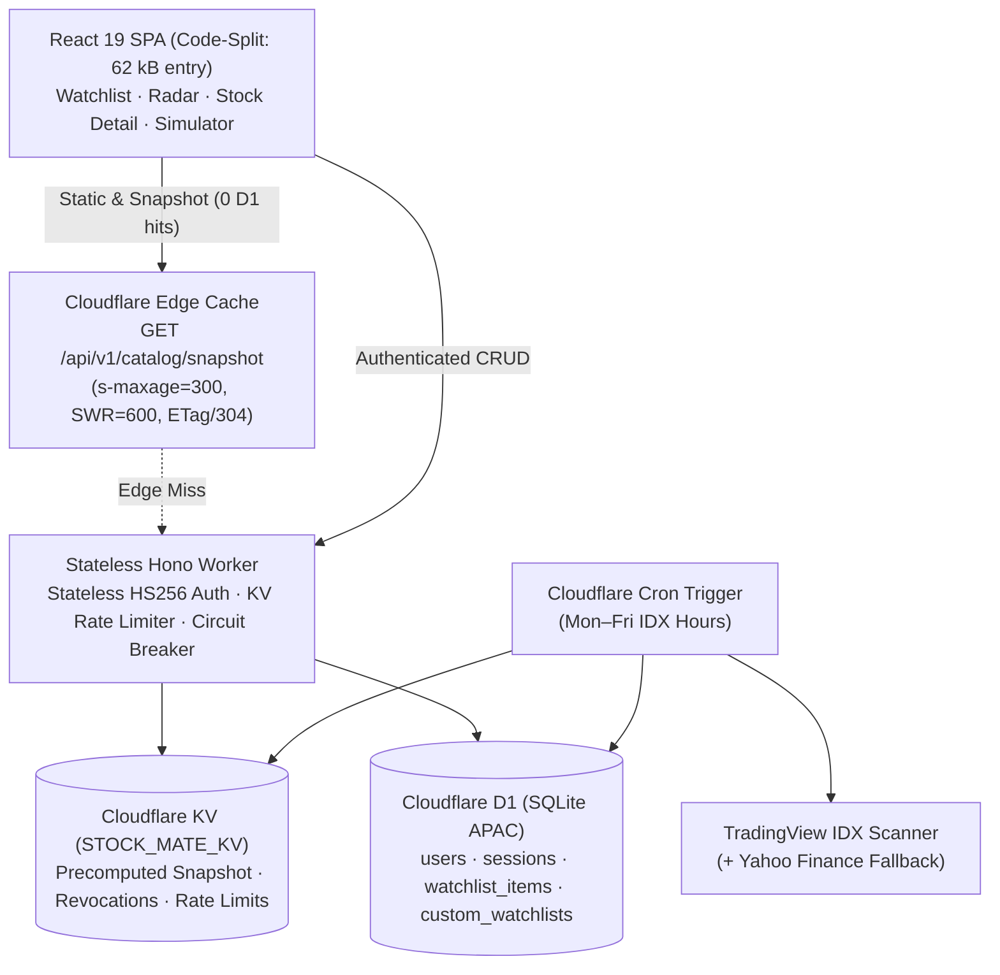

# Stock-Mate v2

> **IDX Fair Value Valuation Engine, Quality Radar & Position Simulator**  
> Built for Indonesian Stock Exchange (**IDX / BEI**) retail investors — Stockbit/Ajaib-inspired compact UX on an edge-native **Cloudflare Workers + D1 + KV** architecture.

🌐 **Live Production App:** https://stock-mate-v2.charlymicolas21.workers.dev  
📐 **100k Scaling Architecture ADR:** [docs/ADR-001-100k-scaling-architecture.md](docs/ADR-001-100k-scaling-architecture.md)

---

## Key Features

### 1. Security-First Auth & OWASP ASVS Hardening
- **Stateless Fast-Path Auth + Instant Revocation:** Issues a 15-minute HMAC-SHA256 access cookie (`__Host-sm_at`) verified in WebCrypto (<0.5ms, **0 D1 hits**) backed by a revocable 7-day DB session (`__Host-sm_session`), KV revocation list, and max-5 active session pruning per user.
- **Audited Cryptography (`@noble/hashes` + Web Crypto):** Native `PBKDF2-SHA256` (100,000 iterations) with constant-time comparison and timing-equalized neutral responses on `/register` to prevent account enumeration.
- **Strict Web Security:** `HttpOnly; Secure; SameSite=Lax` cookies, strict Same-Origin / `X-Requested-With` CSRF guard on state-changing routes, CSP/HSTS/COOP/CORP headers (`public/_headers`), anti-IDOR ownership checks (`404` on foreign IDs), and recursive PII redaction in JSON structured logs.

### 2. Beginner-Friendly Watchlist, Custom Lists & Multi-Entry Portfolio Ledger
- **Portfolio-First Workspace:** Opens directly on your owned holdings (**Portofolio**) with beginner onboarding CTAs (**Cari Saham di Radar** / **Catat Saham yang Dimiliki**), plus tabs for **Semua IHSG** and unlimited **Custom Watchlists**.
- **Broker Mode (Gross) vs Net (After Fees):** Toggle seamlessly between Stockbit-matched gross figures and net figures including `0.15%` buy fee, `0.25%` sell fee, and `Rp 10.000` Bea Materai (`> Rp 10 juta`).
- **Progressive Disclosure Allocation X-Ray:** Compact 1-line concentration status bar (`Seimbang` vs `Peringatan Konsentrasi`) expandable into dual stock (>25%) & sector (>40%) donut charts.
- **Mobile-First Zero-Horizontal-Scroll UX:** Dedicated compact card views on mobile (`md:hidden`), sticky mobile bottom tab navigation, tap-to-toggle beginner glossary tooltips, WCAG AA contrast, and live Toast feedback.

### 3. Radar — Dual-Track Fundamental Quality Score (FQS) & Value Trap Shield
- **4-Pillar FQS (0–100):** Evaluates Profitability, Growth, Financial Health, and Cash Flow Quality with separate **Banking/Financials** vs **Non-Financials** models and Weak-Link risk caps.
- **1-Click Smart Presets:** *Kualitas Lagi Diskon*, *Compounder Stabil*, *Kas Kuat*, and *Tumbuh & Diskon* with collapsible advanced pillar, liquidity (ADTV), and Piotroski F-Score filters.
- **Core-3 Fair Value Engine:** Relative P/E, Relative P/B (primary anchor for `FINANCIALS`), and 5-Year DCF with `Conservative / Moderate / Optimistic` range bar, Margin of Safety, and **IHSG Value Trap Shield**.

### 4. Position-Linked Average Down, Pyramiding & Take-Profit Simulator
- **100% IDX / BEI Compliant:** `1 Lot = 100 shares`, official price tick brackets (`<200: 1`, `200–499: 2`, `500–1999: 5`, `2000–4999: 10`, `≥5000: 25`), buy/sell fees, and Bea Materai `Rp 10.000`.
- **4 Simulation Modes:** Average Down (multi-tranche + exact Real BEP tick), Pyramiding Buy (reconciled cash & stamp duty budget), Take-Profit Ladder (with 100% Free-Ride tracking), and Goal-Seek Target Average.
- **Single Source of Truth:** Pure domain engine in `src/shared/domain/` with **100% line/branch/function/statement test coverage** shared identically by server and client.

---

## High-Level Architecture (Edge-Cached & 100k-Ready)



> See [docs/ADR-001-100k-scaling-architecture.md](docs/ADR-001-100k-scaling-architecture.md) for the full CAP trade-off matrix, D1 Read Replicas → Hyperdrive/PostgreSQL tipping points, and production KV/Secret activation commands.

---

## REST API Endpoints

Base path: `/api/v1` (all errors follow **RFC 7807 `application/problem+json`**).

| Method | Path | Auth | Description |
| :--- | :--- | :---: | :--- |
| `GET` | `/api/v1/health/live` | Public | Lightweight Worker liveness probe (0 DB hits) |
| `GET` | `/api/v1/health/ready` | Public | D1 readiness probe (`SELECT 1`) |
| `GET` | `/api/v1/catalog/snapshot` | Public | Edge-cached precomputed IHSG catalog (`ETag`/`304`, `s-maxage=300`) |
| `POST` | `/api/v1/auth/register` | Public | Register account (neutral anti-enumeration error) & issue auth cookies |
| `POST` | `/api/v1/auth/login` | Public | Verify PBKDF2-SHA256 password, prune >5 sessions, issue auth cookies |
| `POST` | `/api/v1/auth/logout` | Cookie | Revoke D1 session + KV revocation list & clear cookies |
| `GET` | `/api/v1/auth/me` | Cookie | Return authenticated user (0 D1 hits via HS256 fast-path) |
| `GET` | `/api/v1/watchlist` | Cookie | List personal tracked stocks & positions (`LEFT JOIN`, 0 N+1) |
| `POST` | `/api/v1/watchlist` | Cookie | Create watchlist item + fundamentals atomically |
| `GET` | `/api/v1/watchlist/:id` | Cookie | Single stock Core-3 valuation, FQS & position summary |
| `PATCH` | `/api/v1/watchlist/:id` | Cookie | Partial update of price, tranches, thesis, or benchmarks |
| `DELETE` | `/api/v1/watchlist/:id` | Cookie | Atomic soft delete (`UPDATE ... RETURNING id`) |
| `POST` | `/api/v1/watchlist/sync-all` | Cookie | Batch sync user watchlist from shared catalog (`db.batch`) |
| `GET` | `/api/v1/watchlist/catalog` | Cookie | Screener & Radar query backed by precomputed Edge/KV snapshot |
| `POST` | `/api/v1/watchlist/catalog/sync` | Admin/Cookie | Refresh global IHSG catalog (guarded by `CATALOG_SYNC_SECRET` when set) |
| `GET/POST/PATCH/DELETE` | `/api/v1/watchlist/groups/*` | Cookie | Custom watchlists CRUD & ticker membership |
| `GET` | `/api/v1/market-data/idx/:ticker` | Cookie | On-demand IDX quote with circuit breaker + Yahoo fallback |

---

## Local Development & Verification

### Prerequisites
- **Node.js 24+** (required for built-in `node:sqlite` used in API integration tests)
- **npm 10+**

### Setup & Run
```bash
git clone https://github.com/charlybutar21/stock-mate-v2.git
cd stock-mate-v2
npm install
npm run db:migrate:local
npm run dev
```

### Quality Gates & Load Testing
```bash
npm run typecheck      # TypeScript strict check (tsc --noEmit)
npm run lint           # ESLint (TypeScript + React Hooks rules)
npm run test:coverage  # Vitest (100% coverage on src/shared/domain/ + API integration tests)
npm run build          # Production build (Worker + Code-Split Client SPA)
npm run check:bundle   # Enforces client entry < 250 kB & max chunk < 500 kB
npm audit --omit=dev   # Production dependency security audit

# Optional k6 load test (default: safe 20 VU smoke profile; supports stress_10k & scale_100k)
k6 run scripts/load-test.k6.js
```

---

## CI/CD Pipeline

[`.github/workflows/ci.yml`](.github/workflows/ci.yml) enforces on every PR & push to `main`:
1. `npm audit --omit=dev --audit-level=high`
2. `npm run typecheck` & `npm run lint`
3. `npm run test:coverage` (100% `src/shared/domain/` coverage + `EXPLAIN QUERY PLAN` index checks)
4. `npm run build` + `npm run check:bundle` (`< 250 kB` client entry gate)
5. Automatic D1 migration, Cloudflare Workers deploy, and `/health/ready` + `/catalog/snapshot` smoke test on `main`.

> **Disclaimer:** Stock-Mate v2 is an educational and self-analysis tool only — not financial advice or a buy/sell stock recommendation.

## License

MIT
