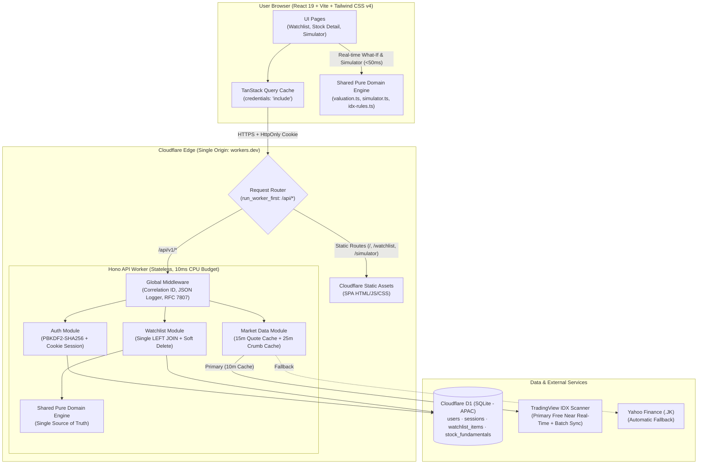
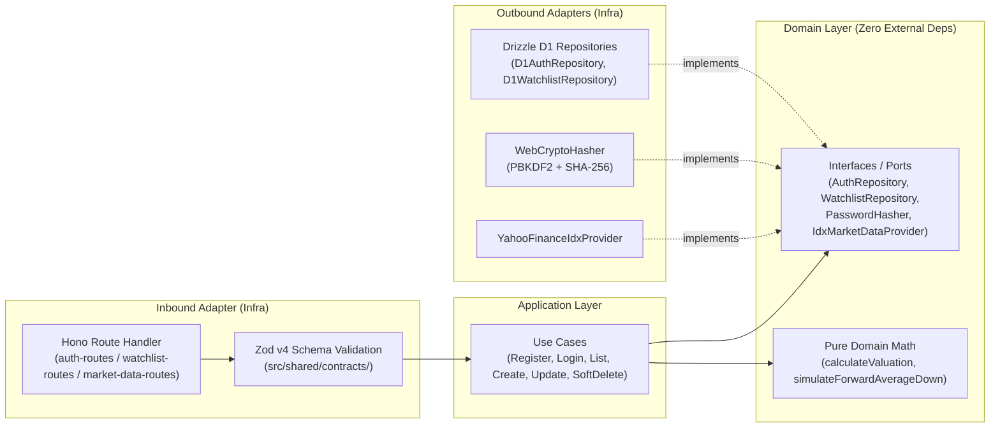
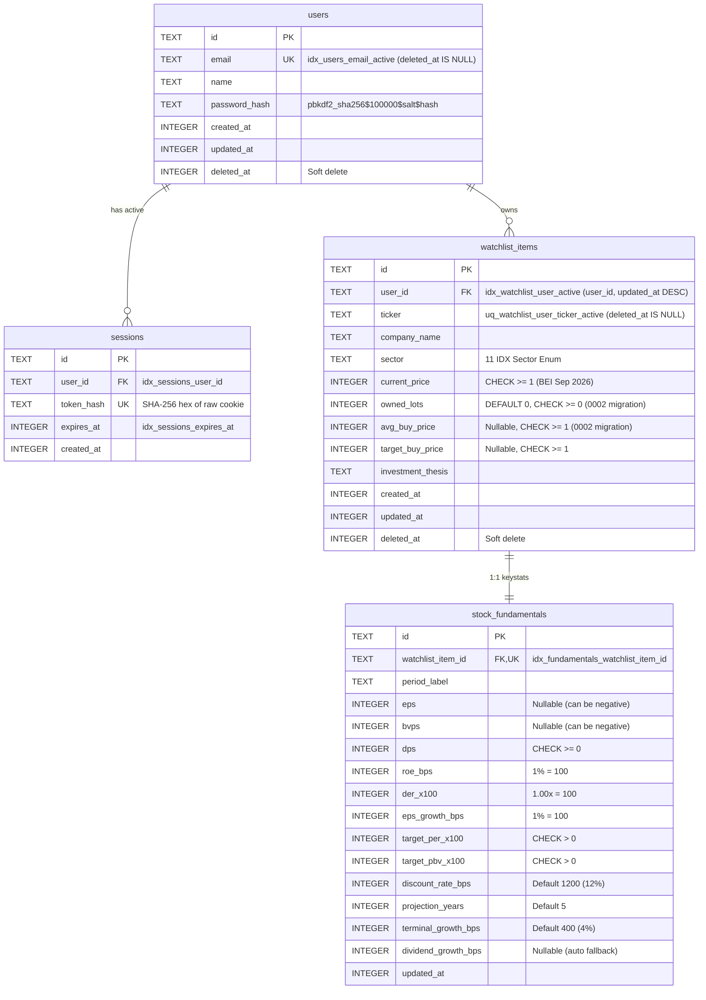
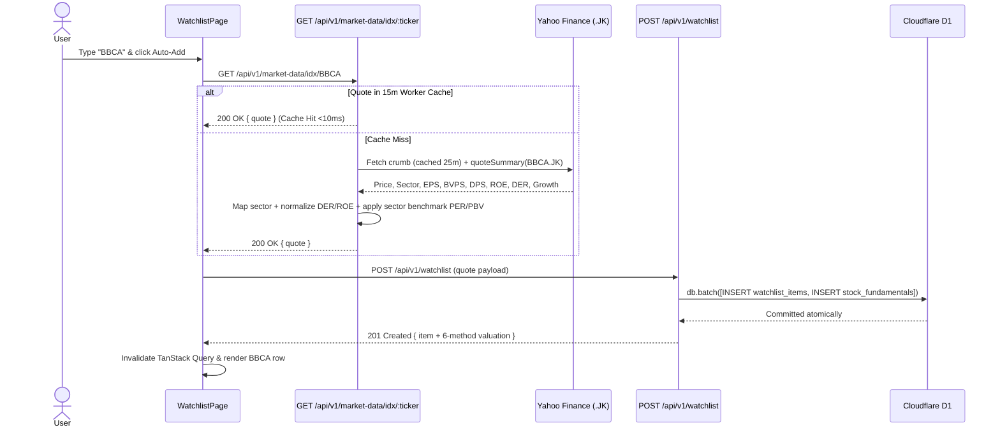

# Stock-Mate v2

> **IDX Fair Value Valuation Engine & Real-Time Stockbit Average Down Simulator**  
> Built for Indonesian Stock Exchange (**IDX / BEI**) retail investors — zero-cost serverless architecture on **Cloudflare Workers + D1**.

🌐 **Live Production App:** https://stock-mate-v2.charlymicolas21.workers.dev  
📋 **PRD & Technical Spec:** [Issue #1 — Stock-Mate v2 MVP v1.0](https://github.com/charlybutar21/stock-mate-v2/issues/1)

---

## Key Features

### 1. Audited Authentication & Security-First Architecture
- **Email + Password** registration and login with zero third-party auth fees.
- **Audited cryptographic primitives (`@noble/hashes` + Web Crypto):** Cure53-audited `@noble/hashes` (`sha256`, CSPRNG `randomBytes`, hex encoding) paired with native Web Crypto `PBKDF2-SHA256` (100,000 iterations, native C++ in Cloudflare V8 within 10ms CPU limit) and constant-time byte verification.
- **Standard Hono Security Middlewares:** Built-in `hono/secure-headers` and `hono/csrf` same-origin protection on all `/api/*` endpoints.
- **DB-backed sessions:** Raw 32-byte token stored only in `HttpOnly; Secure; SameSite=Lax` cookie (`sm_session`); only `SHA-256(token)` is persisted in Cloudflare D1.
- **Anti-IDOR isolation:** Every watchlist read/write enforces `user_id` ownership and returns `404` for unauthorized IDs.

### 2. IDX Watchlist, Position Ledger & 1-Click Auto-Fetch (TradingView IDX)
- **Quick Auto-Add (1-Click):** Enter any 4-letter IDX ticker (e.g. `BBCA`, `BBRI`, `ICBP`, `TLKM`, `ASII`) to automatically fetch near real-time price and TTM key stats via **TradingView Indonesia Scanner** (free, zero API key) with automatic fallback to Yahoo Finance (and optional Sectors.app support via `SECTORS_API_KEY`).
- **Batch Sync All:** Refresh every stock in your watchlist in 1 single batch request (`POST /api/v1/watchlist/sync-all`) while preserving your personal valuation benchmarks, owned lots, and thesis.
- **My Holding Position Tracking:** Record and edit your **Owned Lots** (`owned_lots`) and **Avg Buy Price** (`avg_buy_price`) directly on each stock, showing live **Market Value** and **Unrealized P/L (Rp & %)** on the Watchlist Ledger and Stock Detail page.
- **6 Essential Industry-Standard Key Stats:** Streamlined strictly to the metrics that matter — `EPS (TTM)`, `BVPS`, `ROE (%)`, `DER (x)`, `EPS Growth (YoY %)`, and `Dividend / Share (DPS)` — plus 3 sector-prefilled benchmarks (`Target P/E`, `Target P/B`, `WACC`).

### 3. Core-3 Multi-Method Fair Value Engine (2026 Institutional Standard)
Focuses on the **3 most accurate and relevant valuation anchors** for modern IDX equities, with graceful `N/A` reasons when inputs are negative or missing:
1. **Relative P/E (Earnings Multiple):** $\text{EPS (TTM)} \times \text{Target P/E}$
2. **Relative P/B (Book Value Multiple):** $\text{BVPS} \times \text{Target P/B}$ *(primary valuation anchor for `FINANCIALS` / Banking)*
3. **Discounted Cash Flow — DCF (5-Yr Projected EPS):** $\sum_{t=1}^{5} \frac{\text{EPS}(1+g_{\text{eff}})^t}{(1+r)^t} + \frac{\text{EPS}(1+g_{\text{eff}})^5(1+g_t)}{(r - g_t)(1+r)^5}$ *(growth capped at 20%, configurable WACC)*

Includes:
- **Fair Value Range Bar:** Conservative (Min) / **Moderate (Median)** / Optimistic (Max) vs Market Price.
- **Margin of Safety (MoS %):** `≥ 30%` Undervalued · `0–29.99%` Fairly Valued · `< 0%` Overvalued.
- **Sector-Aware Quality Flags:** ROE strength and DER health (with banking-aware `NOT_APPLICABLE_BANKING` badge for `FINANCIALS`).
- **Interactive What-If Tuning:** Adjust Target P/E, Target P/B, and WACC in real time, with Save/Reset controls.

### 4. Position-Linked Average Down & Sell Simulator
Automatically pre-loads your saved **Owned Lots** and **Avg Buy Price** from the selected Watchlist stock (client-side < 50ms recalculation via shared pure domain engine):
- **Mode 1 — Multi-Tranche Forward:** Existing position + up to 5 planned buy tranches + target sell price → outputs Pure Avg, Effective Avg (incl. buy fee), **Real BEP rounded up to IDX Tick Size (`ceilToIdxTick`)**, Additional Cash Required, Total Capital, Projected Net P/L (`Rp` & `%`), and Before/After Gain-to-BEP comparison.
- **Mode 2 — Goal-Seek Target Average:** Calculates exact **Lots Needed** and **Total Cash Required** to reach a desired average price.
- **Stockbit 2026 Fee Defaults:** `0.15%` Buy / `0.25%` Sell (customizable) + optional **Bea Materai `Rp 10.000`** toggle for gross transactions `> Rp 10.000.000`.
- **Investment Guardrails:** Automatic warning banners if simulated average still exceeds Watchlist Moderate Fair Value or if planned tranches result in an Average Up.

### 5. Bilingual UI & UX Resilience
- **English (`en`)** default with instant **Bahasa Indonesia (`id`)** header switcher (strict compile-time dictionary parity).
- Responsive layout, Skeleton loaders, and React Error Boundaries.

---

## High-Level Architecture (HLA)

Stock-Mate v2 uses a **Zero-Cost Edge Modular Monolith** architecture on **Cloudflare Workers + D1**. A single Vite build (`@cloudflare/vite-plugin`) outputs both the static React SPA and the Hono Worker API behind one origin, eliminating CORS complexity and enabling `HttpOnly; SameSite=Lax` cookie auth out of the box.



### Key Architectural Decisions & Trade-Offs

| Decision | Choice | Why & Trade-Off |
| :--- | :--- | :--- |
| **Deployment Topology** | Single-origin Cloudflare Worker + Static Assets | Eliminates CORS preflights, allows strict `SameSite=Lax` cookies, cold start ~10ms, **USD 0/month** on Free Tier. Trade-off: 10ms JS CPU limit per request. |
| **Password Hashing** | Web Crypto `PBKDF2-SHA256` (100k iterations) | Runs in native C++ inside Cloudflare V8 (stays well within 10ms CPU limit), unlike pure-JS `bcrypt`/`argon2` which time out on Workers Free Tier. |
| **Domain Logic Placement** | Pure TypeScript in `src/shared/domain/` | Zero framework imports; executed on both backend (canonical API response) and frontend (instant What-If & Simulator) so formulas never drift. |
| **Database & Consistency** | Cloudflare D1 (SQLite) with ACID `db.batch()` | Strong consistency for user auth & watchlist mutations (`watchlist_items` + `stock_fundamentals` written atomically). Trade-off: Free Tier meters row scans → every query MUST use indexes (verified via `EXPLAIN QUERY PLAN`). |
| **Market Data Caching** | Cache-Aside in Worker memory (15m quote / 25m crumb) | Keeps Auto-Add fast and avoids hammering Yahoo Finance. Trade-off: cache is per-isolate and data is delayed (~10–15m), mitigated by allowing full manual override. |

---

## Low-Level Design (LLD)

### 1. Clean Architecture (Ports & Adapters) per Module

Every backend module (`auth`, `watchlist`, `market-data`) follows strict inward dependency flow: **Infra → Application → Domain**.



---

### 2. Database Schema (ERD) & Integer Scaling Conventions

Cloudflare D1 (SQLite) has no native `DECIMAL` type. To guarantee **zero floating-point drift**, all monetary values, percentages, and multiples are stored as scaled `INTEGER`s and converted exclusively at the Repository/Use-Case boundary:

- **Rupiah amounts** (`current_price`, `eps`, `bvps`, `dps`, `target_buy_price`): `1 : 1` integer Rupiah (e.g. `Rp 9.000` → `9000`).
- **Percentages (Basis Points)** (`roe_bps`, `eps_growth_bps`, `discount_rate_bps`, `terminal_growth_bps`, `dividend_growth_bps`): `1% = 100 bps` (e.g. `15.50%` → `1550`).
- **Multiples (`x100`)** (`der_x100`, `target_per_x100`, `target_pbv_x100`): `1.00x = 100` (e.g. `22.50x` → `2250`).
- **Timestamps** (`created_at`, `updated_at`, `deleted_at`, `expires_at`): Unix epoch **milliseconds** (`INTEGER`) ↔ ISO-8601 UTC string in API JSON.



> **Query Plan Guarantee:** `D1WatchlistRepository.listByUser` executes a **single `LEFT JOIN`** filtered by `user_id = ? AND deleted_at IS NULL ORDER BY updated_at DESC`, verified in Vitest with `EXPLAIN QUERY PLAN` to use `idx_watchlist_user_active` + `idx_fundamentals_watchlist_item_id` (**0 full table scans, 0 N+1 queries**).

---

### 3. Sequence Flow: Authentication & Protected Requests

```mermaid
sequenceDiagram
    actor User
    participant SPA as React SPA
    participant API as Hono Worker
    participant Crypto as WebCryptoHasher
    participant D1 as Cloudflare D1

    User->>SPA: Submit Email & Password
    SPA->>API: POST /api/v1/auth/login
    API->>D1: SELECT user WHERE email = ? AND deleted_at IS NULL
    D1-->>API: UserEntity (password_hash)
    API->>Crypto: verify(password, password_hash) [PBKDF2 100k + XOR compare]
    Crypto-->>API: true
    API->>Crypto: generateSessionToken() (32B) + sha256(token)
    API->>D1: INSERT INTO sessions (token_hash, expires_at = +7d)
    API-->>SPA: 200 OK + Set-Cookie: sm_session=<raw_hex>; HttpOnly; Secure; SameSite=Lax

    Note over SPA,D1: Subsequent Protected API Call
    SPA->>API: GET /api/v1/watchlist (Cookie: sm_session)
    API->>Crypto: sha256(sm_session)
    API->>D1: SELECT session INNER JOIN users WHERE token_hash = ? AND expires_at > now
    D1-->>API: SessionWithUser
    API->>D1: SELECT watchlist_items LEFT JOIN stock_fundamentals WHERE user_id = ? AND deleted_at IS NULL
    D1-->>API: Joined rows
    API-->>SPA: 200 OK { items: [...with computed ValuationSummary] }
```

---

### 4. Sequence Flow: 1-Click Quick Auto-Add & Atomic Write



---

### 5. Error Handling & Observability Design
- **RFC 7807 Problem Details:** Every `4xx`/`5xx` error is serialized by `src/server/shared/http/problem.ts` with `Content-Type: application/problem+json` containing `type`, `title`, `status`, `detail`, `instance`, `correlationId`, and optional field-level `errors` (flattened from Zod v4). Stack traces are never exposed.
- **Structured Logging & PII Redaction:** Every `/api/*` request receives a `correlationId` (`x-correlation-id` header) and logs structured JSON (`method`, `path`, `status`, `durationMs`). The logger (`src/server/shared/logger.ts`) recursively redacts `password`, `password_hash`, `email`, `cookie`, `authorization`, and `token` keys.

---

## Tech Stack & Project Structure

| Layer | Technology |
| :--- | :--- |
| **Runtime & Hosting** | Cloudflare Workers + Static Assets (`@cloudflare/vite-plugin`, `wrangler.jsonc`) |
| **Backend** | TypeScript + Hono (Clean Architecture / Pragmatic DDD Modular Monolith) |
| **Database & ORM** | Cloudflare D1 (SQLite) + Drizzle ORM + Versioned SQL Migrations |
| **Frontend** | React 19 + Vite 7 + TypeScript + Tailwind CSS v4 (`@theme`) + TanStack Query + React Router 7 |
| **Validation** | Zod v4 (`z.email()`, `z.flattenError()`) shared across server & client |
| **Testing** | Vitest + V8 Coverage (100% coverage on `src/shared/domain/` + real SQLite API integration tests) |
| **Observability** | Structured JSON logs with `correlationId` + PII redaction + RFC 7807 `application/problem+json` errors |

```text
stock-mate-v2/
├── wrangler.jsonc                   # Cloudflare Workers + D1 binding + SPA Static Assets
├── vite.config.ts                   # @cloudflare/vite-plugin + React + Tailwind CSS v4
├── drizzle.config.ts                # Drizzle Kit SQLite config
├── migrations/
│   └── 0001_initial.sql             # Indexed D1 schema (users, sessions, watchlist_items, stock_fundamentals)
├── src/
│   ├── shared/
│   │   ├── domain/                  # Pure TS financial math (0 framework deps, 100% test coverage)
│   │   │   ├── idx-rules.ts         # LOT=100, MIN_PRICE=1, IDX tick brackets, Stockbit fees
│   │   │   ├── valuation.ts         # 6 valuation methods, MoS, median range, quality flags
│   │   │   ├── simulator.ts         # Forward multi-tranche, Goal-Seek, BEP, guardrails
│   │   │   └── __tests__/           # Golden Test Cases 1–5
│   │   └── contracts/               # Shared Zod v4 DTOs (auth, watchlist, market-data, RFC 7807)
│   ├── server/                      # Hono Worker API
│   │   ├── index.ts                 # App assembly, DI, correlationId, RFC 7807 global error handler
│   │   ├── modules/
│   │   │   ├── auth/                # Domain, UseCases, D1AuthRepository, WebCryptoHasher, routes
│   │   │   ├── watchlist/           # Domain, UseCases, D1WatchlistRepository (single LEFT JOIN), routes
│   │   │   └── market-data/         # IdxMarketDataProvider port, YahooFinanceIdxProvider, routes
│   │   ├── shared/                  # Drizzle schema, RFC 7807 helper, auth middleware, JSON logger
│   │   └── __tests__/               # Integration tests (auth, IDOR, soft-delete, EXPLAIN QUERY PLAN)
│   └── client/                      # React + Vite + Tailwind v4 SPA
│       ├── i18n/                    # en.ts (default), id.ts (strictly typed), useI18n.tsx
│       ├── components/ui/           # Presentational primitives, AppShell, Skeleton, ErrorBoundary
│       ├── features/                # auth/, watchlist/, simulator/
│       └── lib/                     # apiClient (credentials: 'include'), IDR/percent formatters
└── .github/workflows/ci.yml         # CI/CD: typecheck -> lint -> test:coverage -> build -> D1 migrate -> deploy
```

---

## REST API Endpoints

Base path: `/api/v1` (all errors follow **RFC 7807 `application/problem+json`**).

| Method | Path | Auth | Description |
| :--- | :--- | :---: | :--- |
| `GET` | `/api/v1/health` | Public | Liveness & D1 readiness check |
| `POST` | `/api/v1/auth/register` | Public | Register account & issue `HttpOnly` session cookie |
| `POST` | `/api/v1/auth/login` | Public | Verify PBKDF2-SHA256 password & issue session cookie |
| `POST` | `/api/v1/auth/logout` | Cookie | Revoke D1 session & clear cookie |
| `GET` | `/api/v1/auth/me` | Cookie | Return current authenticated user |
| `GET` | `/api/v1/watchlist` | Cookie | List active watchlist (`?search=&sector=&sort=mos_desc\|updated_desc\|ticker_asc`) |
| `POST` | `/api/v1/watchlist` | Cookie | Create watchlist item + fundamentals atomically |
| `GET` | `/api/v1/watchlist/:id` | Cookie | Get single item + full 6-method valuation breakdown |
| `PATCH` | `/api/v1/watchlist/:id` | Cookie | Partial update of price, thesis, or fundamentals |
| `DELETE` | `/api/v1/watchlist/:id` | Cookie | Soft delete (`deleted_at`) |
| `POST` | `/api/v1/watchlist/sync-all` | Cookie | Batch sync all active watchlist stocks via TradingView IDX |
| `GET` | `/api/v1/market-data/idx/:ticker` | Cookie | Auto-fetch near real-time IDX quote & TTM key stats (TradingView primary, Yahoo fallback) |

---

## Local Development

### Prerequisites
- **Node.js 24+** (required for built-in `node:sqlite` used in API integration tests)
- **npm 10+**

### Setup & Run
```bash
# 1. Clone repository
git clone https://github.com/charlybutar21/stock-mate-v2.git
cd stock-mate-v2

# 2. Install dependencies
npm install

# 3. Apply local Cloudflare D1 migration
npm run db:migrate:local

# 4. Start local dev server (Vite SPA + Cloudflare Worker + Local D1)
npm run dev
```

Open **http://localhost:5173** in your browser.

### Verification Commands
```bash
npm run typecheck      # TypeScript strict check (tsc --noEmit)
npm run lint           # ESLint (TypeScript + React Hooks rules)
npm run test:coverage  # Vitest (100% coverage on src/shared/domain/ + API integration tests)
npm run build          # Production build (Worker + Client SPA)
```

---

## CI/CD Pipeline (GitHub Actions → Cloudflare Workers)

The workflow in [`.github/workflows/ci.yml`](.github/workflows/ci.yml) runs automatically on every **Pull Request** and **Push to `main`**:

1. **CI Verification Job (`verify`):**
   - `npm ci`
   - `npm run typecheck`
   - `npm run lint`
   - `npm run test:coverage` (enforces 100% coverage on `src/shared/domain/` + `EXPLAIN QUERY PLAN` zero table-scan check)
   - `npm run build`
2. **CD Deployment Job (`deploy` — on push to `main`):**
   - Applies versioned D1 migrations (`npx wrangler d1 migrations apply stock-mate-db --remote`)
   - Builds and deploys to Cloudflare Workers (`npm run deploy`)
   - Verifies production readiness via `GET /api/v1/health`

### Required GitHub Repository Secrets
Configure under **Settings → Secrets and variables → Actions**:
- `CLOUDFLARE_API_TOKEN` — Cloudflare API token with **Workers Scripts: Edit** and **D1: Edit** permissions.
- `CLOUDFLARE_ACCOUNT_ID` — Your Cloudflare Account ID.

### Manual Production Deploy
```bash
npm run db:migrate:remote
npm run deploy
```

---

## License

MIT
