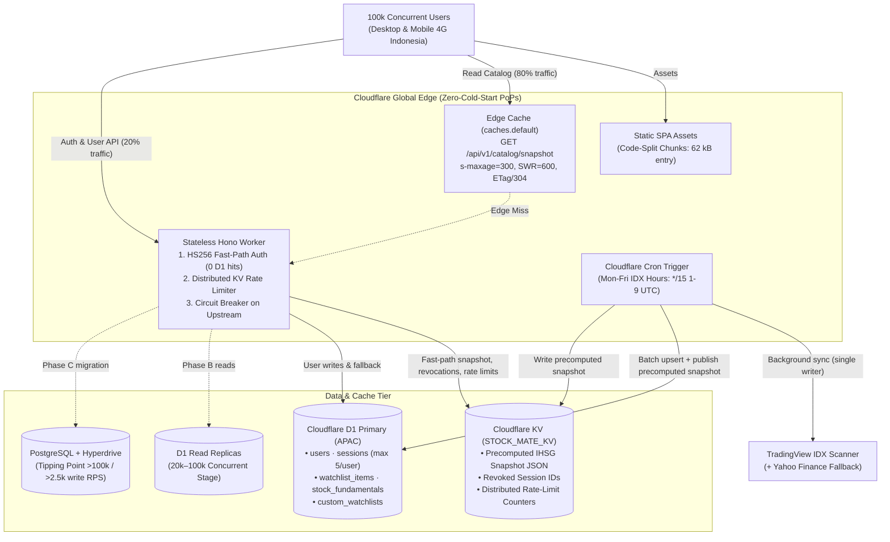

# ADR-001: Scaling Architecture Toward 100,000 Concurrent Users

- **Status:** Accepted & Implemented (Phase 1 Edge/Stateless Foundation Live; KV/Replicas/Hyperdrive Graduated Rollout)
- **Date:** 2026-11-27
- **Scope:** Cloudflare Workers + D1 + KV + Edge Cache for Stock-Mate v2 (IDX / BEI Retail Investors)

---

## 1. Context & SLO Targets

Stock-Mate v2 serves Indonesian retail equity investors (IDX / BEI) with traffic spikes heavily concentrated around **IDX market open (08:45–09:30 WIB)** and **closing auction (15:45–16:15 WIB)**.

| Metric | Target SLO |
| :--- | :--- |
| Concurrent Active Users (Peak) | Up to **100,000 concurrent users** |
| Read Latency (Edge Catalog Snapshot) | **p95 < 200 ms**, p99 < 400 ms |
| Authenticated Read Latency | **p95 < 250 ms**, p99 < 500 ms |
| Availability / Error Budget | **99.9%** (`error rate < 0.1%`) |
| Client Initial Entry Bundle (4G Mobile) | **< 250 kB raw** (currently ~62 kB / ~19.6 kB gzip) |

---

## 2. CAP & Architectural Trade-Off Decisions

| Subsystem | Consistency Model | Storage & Caching Strategy | Trade-Off & Rationale |
| :--- | :--- | :--- | :--- |
| **Shared IHSG Catalog (~900 stocks)** | **Eventual Consistency** (5–15 min freshness via Cron) | **Cloudflare Cron Trigger** → D1 → Precomputed Snapshot in **KV (`STOCK_MATE_KV`)** + **Edge Cache (`caches.default`, `s-maxage=300`, `stale-while-revalidate=600`, `ETag`/`304`)** | Eliminates synchronous TradingView calls inside user requests and prevents cache-stampede / thundering herd. 100k concurrent users hit Cloudflare Edge with **0 D1 reads** and **0 upstream scrapes**. |
| **Auth Session Verification** | **Bounded Eventual Revocation** (15 min access token + KV revocation list) | Short-lived HS256 `__Host-sm_at` (15m) + D1-backed `__Host-sm_session` (7d) + `SessionRevocationStore` (KV + local TTL cache) | Eliminates **~95% of D1 session lookup reads** (`auth-mw.ts` verifies HMAC in <0.5ms using WebCrypto) while preserving instant logout revocation via KV. |
| **User Watchlist & Positions** | **Strong Consistency (ACID)** | Cloudflare D1 (`db.batch()` atomic writes, single `LEFT JOIN`, atomic `UPDATE ... RETURNING id` soft-deletes) | Financial lot counts, buy tranches, and custom watchlists require strict read-your-writes consistency. |
| **Upstream Market Data** | **Graceful Degradation (AP)** | In-isolate **Circuit Breaker** (`failureThreshold=3`, `cooldownMs=60s`) + Yahoo Finance fallback + stale catalog serving | Prevents cascading latency spikes when TradingView/Yahoo rate-limits or degrades. |
| **Rate Limiting** | **Distributed Fixed-Window (AP)** | `STOCK_MATE_KV` distributed counters with automatic in-isolate fallback when KV is unbound | Removes per-isolate memory blind spots across global Cloudflare PoPs. |

---

## 3. Target Architecture Diagram



---

## 4. Graduated Scaling Roadmap & Tipping Points

| Stage | Concurrency / Load | Infrastructure Topology | Est. Monthly Cost | Trigger to Advance |
| :--- | :--- | :--- | :--- | :--- |
| **Phase A (Live Ready)** | 0 – 20,000 concurrent | Workers Paid ($5) + Single D1 + `STOCK_MATE_KV` + Cron Trigger + Edge Cache | **$5 – $25 / mo** | Sustained D1 read latency `p95 > 120ms` or D1 read QPS > 3,000 |
| **Phase B (Regional Scale)** | 20,000 – 100,000 concurrent | Enable **Cloudflare D1 Read Replicas** (`withSession('first-unconstrained')` for reads, `'first-primary'` for writes) + Cloudflare WAF Rate Limiting Rules | **$25 – $80 / mo** | Sustained write RPS > 1,500–2,500 (SQLite single-writer serialization) or DB size > 8 GB |
| **Phase C (Hyper-Scale)** | > 100,000 concurrent | Migrate transactional user tables (`users`, `sessions`, `watchlist_items`, `custom_watchlists`) to **PostgreSQL (Neon / Supabase) behind Cloudflare Hyperdrive**; keep shared IHSG catalog on KV + Edge Cache | **$100 – $300 / mo** | Multi-region write contention or complex analytical SQL requirements |

---

## 5. Production Activation Runbook (KV, Secrets & Cron)

The codebase runs with **graceful fallback** when `STOCK_MATE_KV`, `JWT_SECRET`, or `CATALOG_SYNC_SECRET` are unset (ideal for local dev and preview deploys). To unlock full 100k-ready mode in production:

```bash
# 1. Provision Cloudflare KV namespace
npx wrangler kv namespace create STOCK_MATE_KV
npx wrangler kv namespace create STOCK_MATE_KV --preview

# 2. Paste the generated namespace IDs into wrangler.jsonc under "kv_namespaces"

# 3. Configure production secrets (never commit to git)
npx wrangler secret put JWT_SECRET          # 32+ random bytes for HS256 fast-path auth tokens
npx wrangler secret put CATALOG_SYNC_SECRET # Admin token restricting POST /api/v1/watchlist/catalog/sync

# 4. Deploy Worker + Cron Triggers
npm run db:migrate:remote
npm run deploy

# 5. Validate with k6 load test
k6 run -e BASE_URL=https://stock-mate-v2.charlymicolas21.workers.dev scripts/load-test.k6.js
```
