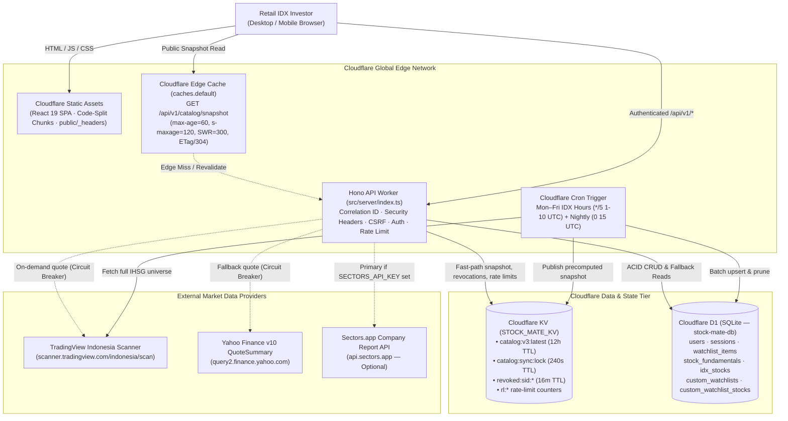
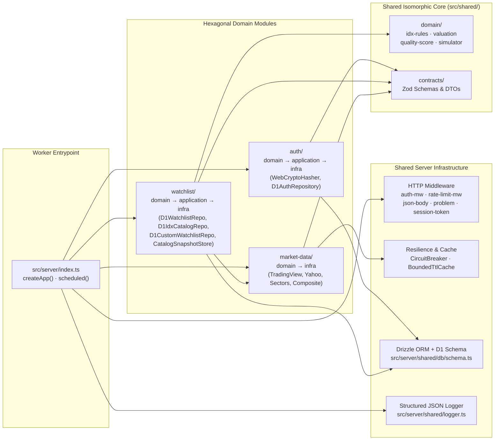
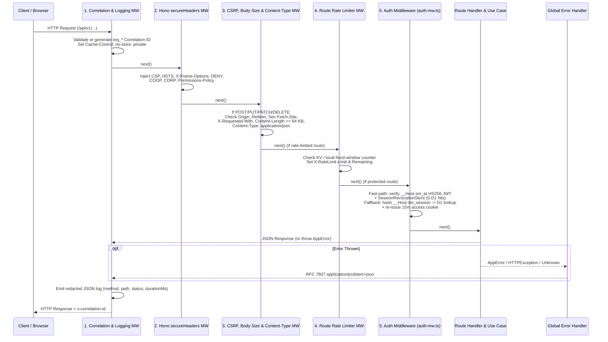

# System Architecture — Stock-Mate v2

> **Document Type:** As-Built Architecture Specification  
> **Parent Document:** [README.md](../README.md)  
> **Related ADR:** [ADR-001: Scaling Architecture Toward 100,000 Concurrent Users](ADR-001-100k-scaling-architecture.md)

---

## Table of Contents

1. [Architectural Style and Core Principles](#1-architectural-style-and-core-principles)
2. [High-Level System Context](#2-high-level-system-context)
3. [Component & Layer Architecture](#3-component--layer-architecture)
4. [Request Lifecycle & Middleware Pipeline](#4-request-lifecycle--middleware-pipeline)
5. [Caching & Edge Scaling Architecture](#5-caching--edge-scaling-architecture)
6. [Frontend SPA Architecture](#6-frontend-spa-architecture)
7. [Shared Isomorphic Domain Layer](#7-shared-isomorphic-domain-layer)
8. [CAP Theorem & Trade-Off Analysis](#8-cap-theorem--trade-off-analysis)
9. [Resilience & Fault Tolerance Patterns](#9-resilience--fault-tolerance-patterns)
10. [Scalability Trajectory](#10-scalability-trajectory)

---

## 1. Architectural Style and Core Principles

Stock-Mate v2 is designed as a **stateless, edge-native, modular monolith** running on **Cloudflare Workers** with a **Single Page Application (SPA)** frontend served via Cloudflare Static Assets.

Core architectural principles verified in the codebase:

- **Hexagonal / Clean Architecture (Ports & Adapters):** Each backend module under `src/server/modules/` separates domain interfaces (`domain/`), orchestration use cases (`application/`), and transport/storage adapters (`infra/`).
- **Isomorphic Single Source of Truth (`src/shared/`):** Pure TypeScript financial domain engines (`idx-rules.ts`, `valuation.ts`, `quality-score.ts`, `simulator.ts`) and Zod API contracts (`src/shared/contracts/`) are imported directly by both the Cloudflare Worker backend and the React 19 SPA, guaranteeing zero calculation drift between server-computed valuations and client-side live what-if / simulator calculations.
- **Stateless Horizontal Scaling:** Zero sticky server sessions; authentication uses short-lived HS256 JWT cookies verified via WebCrypto (`< 0.5 ms`, 0 D1 reads) backed by revocable D1 sessions and Cloudflare KV revocation entries.
- **Multi-Tier Caching & Anti-Thundering-Herd:** Expensive global IHSG (~900 stock) catalog scans are decoupled from user HTTP requests via Cloudflare Cron Triggers and served from a 4-tier hierarchy: Cloudflare Edge Cache (`caches.default`) → Worker in-isolate hot cache (30s with single-flight promise coalescing) → Cloudflare KV (`STOCK_MATE_KV`, 12h TTL) → Cloudflare D1 (`idx_stocks`).
- **Explicit Dependency Injection:** `createApp()` in [`src/server/index.ts`](../src/server/index.ts) wires repositories, hashers, caches, and market-data providers via a `getDeps` factory and accepts test overrides (e.g., mock `marketDataProvider`, custom rate limits).

---

## 2. High-Level System Context



---

## 3. Component & Layer Architecture

### Backend Modules (`src/server/`)



### Routing Boundary (`wrangler.jsonc`)

Cloudflare Assets is configured with:
- `"not_found_handling": "single-page-application"` — any non-asset, non-API route serves `index.html` for React Router v7 client-side routing.
- `"run_worker_first": ["/api/*"]` — all `/api/*` requests bypass static assets and execute the Hono Worker directly.

---

## 4. Request Lifecycle & Middleware Pipeline

Every request matching `/api/*` passes through an ordered middleware chain in [`src/server/index.ts`](../src/server/index.ts):



---

## 5. Caching & Edge Scaling Architecture

Stock-Mate v2 uses a **4-tier snapshot hierarchy** for the shared IHSG catalog (`idx_stocks`) so read traffic scales independently of Cloudflare D1:

| Tier | Component | Location / Key | TTL / Policy | Behavior |
| :--- | :--- | :--- | :--- | :--- |
| **L1** | Cloudflare Edge Cache | `caches.default` on `GET /api/v1/catalog/snapshot` | `public, max-age=60, s-maxage=120, stale-while-revalidate=300` | Serves edge hits globally with `ETag` (`W/"cat-<syncedAtMs>-<count>"`) and `304 Not Modified`. Header `X-Catalog-Cache: EDGE-HIT`. |
| **L2** | Worker In-Isolate Hot Cache | `CatalogSnapshotStore.hotSnapshot` ([`catalog-snapshot-store.ts`](../src/server/modules/watchlist/infra/catalog-snapshot-store.ts)) | `30s` (`ISOLATE_SNAPSHOT_TTL_MS`) | Scoped per `createApp()` instance; uses `inFlightLoad` promise coalescing so concurrent requests share one KV/D1 load. |
| **L3** | Cloudflare KV | `STOCK_MATE_KV` key `catalog:v3:latest` | `12h` (`43,200s`) | Stores precomputed `CatalogSnapshotPayload` (already evaluated by Core-3 valuation + FQS v2 + summary counts). Zero D1 hits on cache hit. |
| **L4** | Cloudflare D1 | `idx_stocks` table | Authoritative SQLite store | Fallback when KV is unbound or cold; automatically backfills KV on load. |

### Stale-While-Revalidate (SWR) Self-Healing

In [`src/server/index.ts`](../src/server/index.ts#L329-L340), `GET /api/v1/catalog/snapshot` evaluates whether the served snapshot needs a non-blocking background refresh (`c.executionCtx.waitUntil(triggerGuardedBackgroundSync(c.env))`):
1. Snapshot age `>= 5 minutes` (`CATALOG_SWR_MAX_AGE_MS`), **or**
2. First item lacks `openPrice` (schema backfill check), **or**
3. Snapshot has `>= 200` stocks but zero `PROPERTY_REAL_ESTATE` items (sector reclassification check).

A KV lock (`catalog:sync:lock`, TTL `240s`) ensures at most one background refresh runs across isolates during the lock window.

### Provider-Level Bounded In-Isolate Caches

Individual market-data adapters maintain memory-bounded `BoundedTtlCache` instances (max 500 entries, expired-first then FIFO eviction) in [`src/server/shared/cache/bounded-ttl-cache.ts`](../src/server/shared/cache/bounded-ttl-cache.ts):
- `TradingViewIdxProvider`: 3-minute quote TTL (`tvQuoteCache`)
- `YahooFinanceIdxProvider`: 15-minute quote TTL (`quoteCache`) + 25-minute Yahoo crumb session TTL (`cachedCrumb`)
- `SectorsIdxProvider`: 15-minute quote TTL (`sectorsQuoteCache`)

---

## 6. Frontend SPA Architecture

The frontend (`src/client/`) is built with **React 19**, **TypeScript 5.9**, **Vite 7**, **Tailwind CSS v4**, **React Router v7**, and **TanStack React Query v5**.

### Provider & Error Boundary Hierarchy (`src/client/App.tsx`)

```
ErrorBoundary (bilingual crash fallback, zero sensitive logging)
 └── ThemeProvider (light/dark, localStorage "stockmate-theme", FOUC prevented by public/theme-init.js)
      └── QueryClientProvider (refetchOnWindowFocus: false, retry: 1)
           └── I18nProvider (lazy-loaded en.ts / id.ts, localStorage "stockmate_lang")
                └── PrivacyProvider (mask balances/lots, localStorage "stockmate_hide_balances")
                     └── CalcModeProvider (BROKER_GROSS default vs NET_AFTER_FEES, localStorage "stockmate_calc_mode")
                          └── ToastProvider (transient accessible feedback toasts)
                               └── BrowserRouter
                                    ├── GuestOnly: /login, /register
                                    └── RequireAuth (wraps AppShell + Suspense):
                                         /watchlist, /watchlist/:id, /radar, /simulator
```

### Code Splitting & Bundle Budgets

- All 6 page routes (`LoginPage`, `RegisterPage`, `WatchlistPage`, `StockDetailPage`, `RadarPage`, `SimulatorPage`) and 3 secondary simulator tabs (`GoalSeekTab`, `PyramidingTab`, `TakeProfitTab`) are lazy-loaded via `React.lazy()`.
- `vite.config.ts` defines deterministic vendor chunks: `react-vendor`, `query-vendor`, `icons-vendor`, `validation-vendor`.
- CI enforces strict bundle budgets via [`scripts/check-bundle-size.mjs`](../scripts/check-bundle-size.mjs):
  - Main client entry (`index-*.js`): **<= 250 kB raw**
  - Any single JS chunk: **<= 500 kB raw**
- TanStack Query auto-refreshes active watchlist, detail, catalog, and custom group queries every **3 minutes** (`AUTO_REFRESH_INTERVAL_MS`, paused when browser tab is hidden via `refetchIntervalInBackground: false`).

---

## 7. Shared Isomorphic Domain Layer

Located in [`src/shared/domain/`](../src/shared/domain/) with **100% enforced Vitest coverage** (lines, branches, functions, statements):

| Module | File | Responsibility |
| :--- | :--- | :--- |
| **IDX Rules** | [`idx-rules.ts`](../src/shared/domain/idx-rules.ts) | IDX lot size (`100`), fee/stamp-duty constants, 11 IDX-IC sectors, tick bracket math (`getIdxTickSize`, `ceilToIdxTick`, `floorToIdxTick`, `stepIdxPrice`), `round2` (no `-0`), 14-day staleness check. |
| **Valuation Engine** | [`valuation.ts`](../src/shared/domain/valuation.ts) | Core-3 valuation (Relative P/E, Relative P/B, 5-year DCF), Conservative/Moderate/Optimistic range, MoS %, valuation status, ROE/DER flags, IHSG Value Trap Shield. |
| **Quality Engine** | [`quality-score.ts`](../src/shared/domain/quality-score.ts) | 4-track FQS v2 (0–100, S–E grading), 4 weighted pillars, piecewise linear interpolation, 7 weak-link caps, QARP quadrant classification, QARP composite rank score. |
| **Simulator & Risk Engine** | [`simulator.ts`](../src/shared/domain/simulator.ts) | Forward multi-tranche average down, Goal-Seek average calculator, Pyramiding 3-stage allocator, Take-Profit ladder & Free-Ride tracker, position summary (`BROKER_GROSS` / `NET_AFTER_FEES`), Portfolio Risk X-Ray (single-stock >25%, sector >40%). |

---

## 8. CAP Theorem & Trade-Off Analysis

| Subsystem | CAP Priority | Consistency Model | Rationale & Trade-Off |
| :--- | :--- | :--- | :--- |
| **Shared IHSG Catalog** | **AP** (Availability + Partition Tolerance) | **Eventual Consistency** (5-min intraday Cron + Edge/KV caching) | Retail investors tolerate 1–5 min quote delay in exchange for sub-200ms global latency and zero upstream rate-limit failures. |
| **Authentication Fast-Path** | **AP** with bounded revocation | **Bounded Eventual Revocation** (15m HS256 JWT + KV denylist + 7d D1 session) | Cuts ~95% of D1 session lookup queries; if KV is momentarily unreachable on read, denylist fails open until 15m JWT expires while D1 remains authoritative on refresh. |
| **User Portfolio & Custom Watchlists** | **CP** (Strong Consistency) | **ACID Transactions** (`db.batch()` on D1 SQLite) | Lot counts, buy tranches, average buy prices, and custom watchlists require strict read-your-writes integrity. |
| **Upstream Market Data** | **AP** (Graceful Degradation) | **Best-Effort with Circuit Breaker + Fallback** | TradingView → Yahoo Finance fallback + cached catalog prevents cascading 5xx errors when external scanners throttle or time out. |
| **Rate Limiting** | **AP** (Best-Effort Distributed) | **Fixed-Window KV Counter** (`get` + `put`) with local Map fallback | Non-atomic KV increment can allow small bursts under concurrent edge hits, trading strict atomicity for low latency and zero Durable Object cost. |

---

## 9. Resilience & Fault Tolerance Patterns

- **Circuit Breaker ([`circuit-breaker.ts`](../src/server/shared/resilience/circuit-breaker.ts)):** Protects `TradingViewIdxProvider` and `YahooFinanceIdxProvider` (`failureThreshold = 3`, `cooldownMs = 60,000 ms`). Yahoo's breaker excludes HTTP `404` (unknown ticker) from counting as an upstream failure.
- **Composite Provider Fallback ([`sectors-provider.ts`](../src/server/modules/market-data/infra/sectors-provider.ts)):** `CompositeIdxMarketDataProvider` cascades `Sectors.app` (if `SECTORS_API_KEY` is configured) → `TradingView` → `Yahoo Finance`.
- **Upstream Timeouts:** All external `fetch()` calls enforce `AbortSignal.timeout()` (`8,000 ms` single/batch quotes; `15,000 ms` full IHSG universe scan).
- **Single-Flight Coalescing:** Both `CatalogSnapshotStore.inFlightLoad` and `ListCatalogStocksUseCase.inFlightBootstrap` deduplicate concurrent cold-start loads within an isolate.
- **Graceful Degradation Without KV/Secrets:** When `STOCK_MATE_KV`, `JWT_SECRET`, or `CATALOG_SYNC_SECRET` are absent (local dev / tests), the Worker falls back seamlessly to D1, per-isolate ephemeral HMAC key, and per-isolate memory rate-limit maps.
- **Frontend Error Boundary:** [`ErrorBoundary.tsx`](../src/client/components/ui/ErrorBoundary.tsx) catches unexpected React rendering exceptions and renders a localized recovery UI without exposing stack traces or state.

---

## 10. Scalability Trajectory

Per [ADR-001](ADR-001-100k-scaling-architecture.md), the architecture supports graduated scaling:

1. **Current Stage (Phase A — 0 to ~20k concurrent users):** Single Cloudflare D1 APAC primary + `STOCK_MATE_KV` + Cron Trigger (`*/5 1-10 * * 1-5` and `0 15 * * *`) + Edge Cache on `/api/v1/catalog/snapshot`.
2. **Phase B (20k – 100k concurrent users):** Enable Cloudflare D1 Read Replicas (`withSession('first-unconstrained')` for read endpoints, `'first-primary'` for writes) and Cloudflare WAF Rate Limiting Rules.
3. **Phase C (>100k concurrent / >2.5k write RPS):** Migrate transactional user tables to PostgreSQL behind Cloudflare Hyperdrive while retaining KV + Edge Cache for the shared IHSG catalog.

> **Current Implementation Note:** The SPA's `WatchlistPage` and `RadarPage` currently call authenticated `GET /api/v1/watchlist/catalog` (which reads the precomputed catalog from `CatalogSnapshotStore` / KV and overlays user D1 records in the Worker) rather than fetching the public edge-cached `GET /api/v1/catalog/snapshot` directly from the browser. See [Known Limitations](../README.md#20-known-limitations-and-technical-debt).
