# Deployment Guide — Stock-Mate v2

> **Document Type:** As-Built Build, CI/CD & Deployment Specification  
> **Parent Document:** [README.md](../README.md)  
> **CI/CD Workflow:** [`.github/workflows/ci.yml`](../.github/workflows/ci.yml) · **Runtime Config:** [`wrangler.jsonc`](../wrangler.jsonc)

---

## Table of Contents

1. [Deployment Topology](#1-deployment-topology)
2. [Prerequisites & Tooling](#2-prerequisites--tooling)
3. [Cloudflare Resource Provisioning (First-Time Setup)](#3-cloudflare-resource-provisioning-first-time-setup)
4. [Secrets & Configuration Management](#4-secrets--configuration-management)
5. [Build Process & Bundle Verification](#5-build-process--bundle-verification)
6. [Database Migrations](#6-database-migrations)
7. [Automated CI/CD Pipeline (GitHub Actions)](#7-automated-cicd-pipeline-github-actions)
8. [Manual Deployment Procedure](#8-manual-deployment-procedure)
9. [Post-Deployment Verification & Smoke Tests](#9-post-deployment-verification--smoke-tests)
10. [Rollback Strategy](#10-rollback-strategy)

---

## 1. Deployment Topology

Stock-Mate v2 deploys as a **single unified Cloudflare Worker** (`stock-mate-v2`) with bundled static SPA assets (`@cloudflare/vite-plugin`), a Cloudflare D1 database (`stock-mate-db`), a Cloudflare KV namespace (`STOCK_MATE_KV`), and two Cloudflare Cron Triggers.

- **Production URL (configured in CI smoke tests & README):** `https://stock-mate-v2.charlymicolas21.workers.dev`
- **Worker Compatibility Date:** `2026-11-01` (`wrangler.jsonc`)
- **Observability:** `"observability": { "enabled": true }` (Cloudflare Workers Logs enabled)

---

## 2. Prerequisites & Tooling

- **Node.js 24+** (mandatory for built-in `node:sqlite` used by Vitest API integration tests; CI uses `node-version: 24`)
- **npm 10+**
- **Cloudflare Account** with Workers, D1, and KV permissions
- **Wrangler CLI** (bundled as devDependency `wrangler ^4.47.0`, run via `npx wrangler`)

---

## 3. Cloudflare Resource Provisioning (First-Time Setup)

If deploying to a new Cloudflare account or separate staging environment:

```bash
# 1. Authenticate Wrangler locally
npx wrangler login

# 2. Create the D1 database
npx wrangler d1 create stock-mate-db

# 3. Create production and preview KV namespaces
npx wrangler kv namespace create STOCK_MATE_KV
npx wrangler kv namespace create STOCK_MATE_KV --preview

# 4. Update database_id, kv id, and preview_id in wrangler.jsonc
```

---

## 4. Secrets & Configuration Management

Never commit secrets to git or `wrangler.jsonc`. Provision runtime secrets via Wrangler CLI:

```bash
# Required for multi-PoP stateless HS256 fast-path auth (generate >= 32 random bytes)
npx wrangler secret put JWT_SECRET

# Recommended: locks POST /api/v1/watchlist/catalog/sync to Bearer admin token
npx wrangler secret put CATALOG_SYNC_SECRET

# Optional: activates Sectors.app as primary single-quote provider
npx wrangler secret put SECTORS_API_KEY
```

### GitHub Actions Repository Secrets (for Automated CD)

| Secret Name | Purpose |
| :--- | :--- |
| `CLOUDFLARE_API_TOKEN` | Scoped API token with Workers Scripts Edit, D1 Edit, and KV Edit permissions. |
| `CLOUDFLARE_ACCOUNT_ID` | Target Cloudflare Account ID. |

> If either GitHub secret is absent, the `deploy` job in [`.github/workflows/ci.yml`](../.github/workflows/ci.yml) safely skips deployment with a notice instead of failing the workflow.

---

## 5. Build Process & Bundle Verification

```bash
# Full production build (Vite client SPA + Cloudflare Worker bundle via @cloudflare/vite-plugin)
npm run build

# Verify client bundle budgets (entry index-*.js <= 250 kB raw; any single chunk <= 500 kB raw)
npm run check:bundle
```

Build outputs are emitted to `dist/` (ignored by git):
- `dist/client/assets/` — Code-split client JS chunks (`index-*.js`, `react-vendor-*.js`, `query-vendor-*.js`, `icons-vendor-*.js`, `validation-vendor-*.js`, lazy route/tab chunks) and compiled Tailwind CSS.
- Worker bundle configured by `@cloudflare/vite-plugin` pointing to `src/server/index.ts`.

---

## 6. Database Migrations

Migrations live in [`migrations/`](../migrations/) (`0001_initial.sql` through `0007_add_intraday_price_fields.sql`) and are applied sequentially by Wrangler:

```bash
# Apply migrations to local Miniflare D1 instance
npm run db:migrate:local
# Equivalent: wrangler d1 migrations apply stock-mate-db --local

# Apply migrations to remote Cloudflare D1 production database
npm run db:migrate:remote
# Equivalent: wrangler d1 migrations apply stock-mate-db --remote
```

> **Production Safety:** Always apply D1 migrations **before** deploying Worker code that reads new columns (automated in CI). Avoid destructive column/table drops without backward-compatible multi-step rollouts.

---

## 7. Automated CI/CD Pipeline (GitHub Actions)

Defined in [`.github/workflows/ci.yml`](../.github/workflows/ci.yml), triggered on every `push` and `pull_request` to `main` (with `concurrency` cancellation of superseded runs):

```mermaid
flowchart LR
    Trigger["Push / PR to main"] --> Audit["1. npm audit --omit=dev<br/>(--audit-level=high)"]
    Audit --> Type["2. npm run typecheck<br/>(tsc --noEmit)"]
    Type --> Lint["3. npm run lint<br/>(ESLint 9 + React Hooks)"]
    Lint --> Test["4. npm run test:coverage<br/>(Vitest: 100% domain + API)"]
    Test --> Build["5. npm run build"]
    Build --> Bundle["6. npm run check:bundle<br/>(Entry <= 250 kB)"]
    Bundle -->|"push to main & secrets set"| Migrate["7. wrangler d1 migrations<br/>apply --remote"]
    Migrate --> Deploy["8. npm run deploy<br/>(vite build && wrangler deploy)"]
    Deploy --> Smoke["9. Smoke Test<br/>/health/ready & /catalog/snapshot"]
```



---

## 8. Manual Deployment Procedure

```bash
# 1. Run full local verification suite
npm audit --omit=dev --audit-level=high
npm run typecheck
npm run lint
npm run test:coverage
npm run build
npm run check:bundle

# 2. Apply pending D1 migrations to remote database
npm run db:migrate:remote

# 3. Build & deploy Worker + Static Assets + Cron Triggers
npm run deploy
```

---

## 9. Post-Deployment Verification & Smoke Tests

Run immediately after deployment:

```bash
# 1. Verify liveness (0 D1 hits)
curl --fail --silent https://stock-mate-v2.charlymicolas21.workers.dev/api/v1/health/live

# 2. Verify D1 readiness
curl --fail --silent https://stock-mate-v2.charlymicolas21.workers.dev/api/v1/health/ready

# 3. Verify Edge-cached catalog snapshot & cache headers
curl -i --silent https://stock-mate-v2.charlymicolas21.workers.dev/api/v1/catalog/snapshot | head -n 20

# 4. Optional k6 smoke load test (20 VUs for 40s)
k6 run -e BASE_URL=https://stock-mate-v2.charlymicolas21.workers.dev scripts/load-test.k6.js
```

Expected smoke test criteria:
- `/api/v1/health/ready` returns `200` with `{"status":"ok","db":"ok"}`.
- `/api/v1/catalog/snapshot` returns `200` with `ETag`, `Cache-Control`, and `X-Catalog-Cache` headers.
- k6 thresholds pass: `edge_read_duration p(95)<200ms`, `auth_read_duration p(95)<250ms`, `app_error_rate < 0.1%`.

---

## 10. Rollback Strategy

- **Application Rollback (Worker + Static Assets):** Cloudflare Workers versions support instant rollback via Wrangler:
  ```bash
  npx wrangler deployments list
  npx wrangler rollback
  ```
- **Database Rollback:** D1 migrations are forward-only SQL scripts. Because migrations `0001`–`0007` are additive (`CREATE TABLE` / `ALTER TABLE ADD COLUMN`), rolling back application code to a previous release generally remains schema-compatible. For catastrophic data recovery, rely on Cloudflare D1 Time Travel (platform capability; retention window depends on Cloudflare plan — **not verified in repository configuration**).
