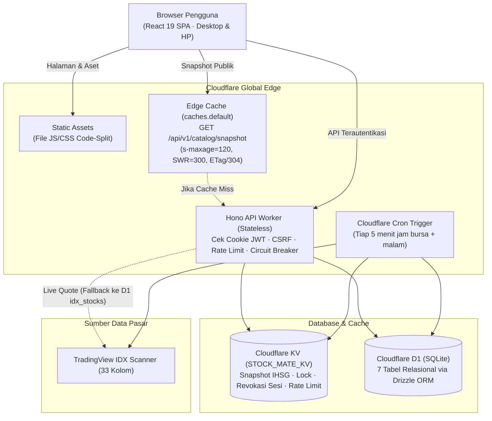

# Dokumentasi Lengkap Stock-Mate v2 (Versi Bahasa Indonesia)

> **Catatan:** Ini adalah versi Bahasa Indonesia yang disusun agar mudah dipahami secara menyeluruh (dari sisi bisnis, fitur, aturan hitung, arsitektur teknis, database, API, keamanan, hingga operasional). Semua isi di sini **100% mencerminkan kode yang saat ini berjalan** (*As-Built*), bukan fitur rencana.

- **Aplikasi Produksi:** https://stock-mate-v2.charlymicolas21.workers.dev
- **Repositori:** https://github.com/charlybutar21/stock-mate-v2
- **Dokumentasi Pendukung (Bahasa Indonesia):**
  - [Arsitektur Sistem (`architecture.md`)](architecture.md)
  - [Spesifikasi Fitur (`functional-specification.md`)](functional-specification.md)
  - [Aturan Bisnis & Rumus (`business-rules.md`)](business-rules.md)
  - [Desain Database & KV (`database-design.md`)](database-design.md)
  - [Spesifikasi REST API (`api-specification.md`)](api-specification.md)
  - [Panduan Integrasi (`integration-guide.md`)](integration-guide.md)
  - [Panduan Deploy & CI/CD (`deployment-guide.md`)](deployment-guide.md)
  - [Panduan Operasional & Troubleshooting (`operational-runbook.md`)](operational-runbook.md)

---

## Daftar Isi

1. [Gambaran Umum Produk](#1-gambaran-umum-produk)
2. [Tujuan & Batasan Sistem](#2-tujuan--batasan-sistem)
3. [Fitur Utama](#3-fitur-utama)
4. [Ringkasan Spesifikasi Fitur & Halaman](#4-ringkasan-spesifikasi-fitur--halaman)
5. [Inti Aturan Bisnis & Rumus Saham IDX](#5-inti-aturan-bisnis--rumus-saham-idx)
6. [Alur Proses Bisnis End-to-End](#6-alur-proses-bisnis-end-to-end)
7. [Arsitektur Sistem](#7-arsitektur-sistem)
8. [Teknologi yang Dipakai (Tech Stack)](#8-teknologi-yang-dipakai-tech-stack)
9. [Struktur Folder & Tanggung Jawab Tiap Komponen](#9-struktur-folder--tanggung-jawab-tiap-komponen)
10. [Desain Database & Penyimpanan](#10-desain-database--penyimpanan)
11. [Ringkasan API Endpoint](#11-ringkasan-api-endpoint)
12. [Integrasi Internal & Eksternal](#12-integrasi-internal--eksternal)
13. [Background Job & Sinkronisasi Otomatis](#13-background-job--sinkronisasi-otomatis)
14. [Autentikasi, Otorisasi & Keamanan](#14-autentikasi-otorisasi--keamanan)
15. [Konfigurasi & Environment](#15-konfigurasi--environment)
16. [Cara Menjalankan di Lokal](#16-cara-menjalankan-di-lokal)
17. [Testing & Penjaga Kualitas](#17-testing--penjaga-kualitas)
18. [Build, CI/CD & Deploy](#18-build-cicd--deploy)
19. [Monitoring, Logging & Troubleshooting](#19-monitoring-logging--troubleshooting)
20. [Keterbatasan & Technical Debt Saat Ini](#20-keterbatasan--technical-debt-saat-ini)
21. [Kepemilikan Layanan & Perawatan](#21-kepemilikan-layanan--perawatan)

---

## 1. Gambaran Umum Produk

**Stock-Mate v2** adalah aplikasi web riset saham, pencatat portofolio, dan simulator transaksi yang dibuat khusus untuk **investor ritel Bursa Efek Indonesia (IDX / BEI)**.

Sederhananya, aplikasi ini membantu investor menjawab 4 pertanyaan utama dalam satu tempat:
1. **Berapa harga wajarnya?** → Dihitung otomatis lewat mesin **Core-3 Fair Value** (Relative P/E, Relative P/B, dan Simple DCF 5 tahun).
2. **Apakah perusahaannya benar-benar bagus atau cuma "murah jebakan"?** → Dinilai lewat **Fundamental Quality Score (FQS v2)** 4-jalur (nilai `0–100`, grade `S` sampai `E`) ditambah **IHSG Value Trap Shield**.
3. **Bagaimana kondisi portofolio saya sekarang?** → Catat kepemilikan multi-cicilan (*tranches*), lihat untung/rugi dalam mode **Broker Gross** (ala Stockbit) atau **Net After Fees**, dan cek risiko konsentrasi saham/sektor lewat **Allocation X-Ray**.
4. **Kalau mau average down, cicil bertahap, atau take profit, berapa lot & di harga berapa?** → Simulasikan langsung dengan aturan resmi BEI (1 lot = 100 lembar, 5 fraksi harga, fee beli `0.15%`, fee jual `0.25%`, dan opsi Bea Materai `Rp 10.000`).

> **Disclaimer:** Stock-Mate v2 adalah alat edukasi dan analisis pribadi, bukan saran keuangan atau rekomendasi beli/jual saham.

---

## 2. Tujuan & Batasan Sistem

### Yang Sudah Dibangun (In Scope)
- Registrasi & login email/password dengan sesi cookie aman (`HttpOnly`) dan rotasi sesi otomatis.
- Pencatatan portofolio multi-tranche (maks. 20 cicilan beli per saham), watchlist kustom (maks. 30 daftar), dan screener seluruh saham aktif IHSG (~900 emiten).
- Sinkronisasi data saham IHSG otomatis tiap 5 menit selama jam bursa (via TradingView 33 kolom + fallback otomatis ke katalog D1 `idx_stocks`).
- Mesin valuasi Core-3, FQS v2 4-track, QARP Screener (*Radar*), dan 4 mode Simulator IDX.
- Antarmuka dwibahasa (`EN` / `ID`), mode Terang/Gelap (*Light/Dark*), tombol sensor saldo (*Privacy Mode*), dan mode responsif HP tanpa scroll menyamping.

### Yang Belum / Tidak Termasuk Saat Ini (Out of Scope)
- Eksekusi order langsung ke sekuritas, pencatatan saldo RDN, riwayat transaksi beli/jual lampau (*realized P&L*), atau penyesuaian *corporate action* otomatis (*stock split*, *rights issue*).
- Chart candlestick intraday/real-time WebSocket atau orderbook Level 2.
- Fitur lupa password, verifikasi email, login Google/OAuth, 2FA/MFA, atau panel admin khusus.
- Menyimpan hasil skenario Simulator ke database (saat ini kalkulasi Simulator bersifat langsung di browser).

---

## 3. Fitur Utama

1. **Portofolio, Semua IHSG & Custom Watchlist (`/watchlist`):**
   - Langsung membuka tab **Portofolio** (saham yang dimiliki) dengan ringkasan Nilai Pasar, Modal Diinvestasikan, dan Untung/Rugi (*Unrealized P/L*).
   - **Allocation X-Ray:** Baris status ringkas (`Seimbang` vs `Peringatan Konsentrasi`) yang bisa dibuka menjadi 2 grafik donat interaktif (peringatan jika 1 saham `> 25%` atau 1 sektor `> 40%`).
   - Tab **Semua IHSG** menampilkan seluruh saham aktif 4 huruf lengkap dengan harga pembukaan (*open*), perubahan harian, harga wajar, Margin of Safety (MoS), dan Grade FQS.
   - **Custom Watchlist:** Buat daftar pantauan bertema sendiri (maks. 30 grup, maks. 100 saham/grup).
2. **Detail Saham & Meja Kerja What-If (`/watchlist/:id`):**
   - Menampilkan rasio pasar (P/E, P/B, Dividend Yield, PEG), rincian 3 metode Harga Wajar + bar rentang `Konservatif / Moderat / Optimistis`, skor FQS 4 pilar, dan peringatan Value Trap.
   - Bisa ubah asumsi `Target PER`, `Target PBV`, dan `Discount Rate` secara *real-time* (tanpa lemot/tanpa loading server) lalu simpan jika cocok.
   - Editor riwayat beli multi-tranche (harga beli mendukung 2 desimal persis seperti Stockbit, misal `Rp 4,825.67`).
3. **Radar — Screener Kualitas & Valuasi (`/radar`):**
   - 5 preset sekali klik: *Semua Saham*, *Prime Opportunity (Kualitas Lagi Diskon)*, *Compounder Stabil*, *Fortress Cash (Kas Kuat)*, dan *GARP (Tumbuh & Diskon)*.
   - Filter per Grade (`S–E`), status valuasi, likuiditas (`ADTV ≥ Rp 1 Miliar`), bebas jebakan *High-Risk Value Trap*, plus filter lanjutan per pilar & Piotroski F-Score.
4. **Simulator IDX Terhubung ke Posisi (`/simulator`):**
   - **Average Down (Forward):** Simulasi hingga 5 rencana beli tambahan + titik impas riil sesuai fraksi BEI (*Real BEP Tick*).
   - **Pyramiding Buy:** Bagi modal tunai otomatis jadi 3 tahap (`20/30/50`, `33/33/34`, atau `15/35/50`) sesuai fraksi harga BEI.
   - **Take-Profit Ladder:** Rencana jual bertahap (1–5 level, bisa auto-isi dari Harga Wajar) + deteksi status **100% Free-Ride** (modal awal sudah balik penuh, sisa saham gratis).
   - **Goal-Seek:** Hitung persis berapa lot dan dana yang dibutuhkan agar harga rata-rata turun ke target tertentu.

---

## 4. Ringkasan Spesifikasi Fitur & Halaman

> Penjelasan detail tiap halaman ada di [**`docs/id/functional-specification.md`**](functional-specification.md).

| Rute Web | Akses | Kegunaan Utama |
| :--- | :---: | :--- |
| `/login` & `/register` | Tamu | Masuk & daftar akun baru |
| `/watchlist` | Login | Portofolio, X-Ray Konsentrasi, Semua Saham IHSG, Custom Watchlist |
| `/watchlist/:id` | Login | Analisis valuasi mendalam, simulasi *What-If*, FQS X-Ray, edit posisi/tranche |
| `/radar` | Login | Screener QARP & FQS 4-Track dengan preset pintar & modal X-Ray |
| `/simulator` | Login | Simulator Average Down, Pyramiding, Take-Profit Ladder, dan Goal-Seek |

---

## 5. Inti Aturan Bisnis & Rumus Saham IDX

> Rumus lengkap, tabel skor per pilar, dan 7 batas pengaman (*Weak-Link Caps*) dijelaskan rinci di [**`docs/id/business-rules.md`**](business-rules.md).

- **Aturan Dasar BEI ([`idx-rules.ts`](../../src/shared/domain/idx-rules.ts)):**
  - `1 Lot = 100 lembar`, harga minimal `Rp 1` (mendukung saham FCA/papan pemantauan khusus di bawah Rp 50).
  - 5 Fraksi Harga Resmi: `< 200` (±1), `200–499` (±2), `500–1.999` (±5), `2.000–4.999` (±10), `≥ 5.000` (±25).
  - Fee default: Beli `0,15%`, Jual `0,25%`. Bea Materai `Rp 10.000` (opsional, default mati) berlaku jika nilai bruto transaksi `> Rp 10.000.000`.
- **Core-3 Harga Wajar ([`valuation.ts`](../../src/shared/domain/valuation.ts)):**
  - 3 metode: **Relative P/E** (`EPS × Target PER`), **Relative P/B** (`BVPS × Target PBV`), dan **Simple DCF 5 Tahun** (pertumbuhan dibatasi `[-20%, +20%]`, default *discount rate* `12%`, *terminal growth* `4%`).
  - Harga Wajar **Moderat** = nilai tengah (*median*) dari metode yang valid. Status: **Undervalued** (`MoS ≥ 30%`), **Fairly Valued** (`0% – 29,99%`), **Overvalued** (`< 0%`).
- **FQS v2 4-Track ([`quality-score.ts`](../../src/shared/domain/quality-score.ts)):**
  - Bobot 4 pilar (Profitabilitas, Pertumbuhan, Kesehatan Keuangan, Arus Kas) disesuaikan untuk 4 kelompok bisnis: **Financials/Bank**, **Cyclicals (Energi & Tambang)**, **Properti & Infrastruktur**, dan **Non-Financials Umum**.
  - Grade ketat: **`S`** (`≥ 88`), **`A`** (`76–87`), **`B`** (`64–75`), **`C`** (`50–63`), **`D`** (`35–49`), **`E`** (`< 35`).
  - Dilengkapi **7 Weak-Link Caps** (rem skor otomatis) — misalnya perusahaan rugi tidak mungkin dapat skor di atas `45`, dan saham dengan Altman Z `< 1,8` (risiko bangkrut) dibatasi maksimal `55`.
- **Batasan Kuota Akun:** Maksimal `200` saham pribadi, `20` tranche beli/saham, `30` custom watchlist, `100` ticker/custom watchlist, dan `5` sesi login aktif per pengguna.

---

## 6. Alur Proses Bisnis End-to-End

### Dari Riset Saham Sampai Eksekusi & Pantau Portofolio

```mermaid
flowchart LR
    A["1. Login / Daftar"] --> B["2. Cari Saham di Radar<br/>atau Semua IHSG"]
    B --> C["3. Cek Skor FQS &<br/>Value Trap Shield"]
    C --> D["4. Buka Detail Saham<br/>(Otomatis Ensure ke Akun)"]
    D --> E["5. Uji Asumsi What-If<br/>(PER / PBV / DCF)"]
    E --> F["6. Rencanakan di Simulator<br/>(Avg Down / Pyramid / TP)"]
    F --> G["7. Catat Posisi Beli<br/>(Multi-Tranche)"]
    G --> H["8. Pantau P/L & Risiko<br/>Konsentrasi Portofolio"]
```



---

## 7. Arsitektur Sistem

> Detail lengkap alur request, 4 lapis cache, dan analisis CAP Theorem ada di [**`docs/id/architecture.md`**](architecture.md).



**Kenapa arsitektur ini cepat dan hemat biaya?**
1. **Satu Mesin Hitung untuk Server & Browser (`src/shared/domain/`):** Rumus valuasi dan simulator ditulis sekali, dipakai di server sekaligus di browser. Hasilnya pasti 100% sama.
2. **Tanpa Bebani Database Saat Cek Login:** Setelah login, user mendapat cookie akses singkat 15 menit (`__Host-sm_at`). Worker memverifikasi tanda tangan HMAC-nya langsung di memori (`< 0,5 ms`, **0 query ke D1**).
3. **Data ~900 Saham IHSG Tidak Di-scrape Saat User Membuka Halaman:** Cron Trigger yang mengambil data dari TradingView di latar belakang, menghitung valuasi & FQS sekaligus, lalu menyimpannya ke KV sebagai satu *snapshot* siap saji.

---

## 8. Teknologi yang Dipakai (Tech Stack)

| Bagian | Teknologi | Peran |
| :--- | :--- | :--- |
| **Platform Edge** | Cloudflare Workers + Static Assets | Menjalankan backend API, Cron Job, sekaligus hosting SPA |
| **Backend Web** | Hono (`^4.10.0`) + Zod (`^4.1.0`) | Routing API cepat & validasi input ketat |
| **Database & Cache** | Cloudflare D1 (SQLite) + Drizzle ORM + Cloudflare KV | Penyimpanan data relasional ACID & cache global |
| **Kriptografi** | Web Crypto API + `@noble/hashes` | Hash password PBKDF2-SHA256 (100.000 iterasi) & token SHA-256 |
| **Frontend** | React 19 + React Router v7 + TanStack Query v5 + Tailwind CSS v4 | SPA modern, auto-refresh 3 menit, desain responsif light/dark |
| **Build & Test** | Vite 7 + TypeScript 5.9 + Vitest 4 + ESLint 9 + k6 | Bundling ringan, 100% test coverage domain, uji beban |

---

## 9. Struktur Folder & Tanggung Jawab Tiap Komponen

| Folder / File | Tanggung Jawab |
| :--- | :--- |
| [`src/shared/domain/`](../../src/shared/domain/) | Otak perhitungan murni (aturan IDX, Core-3 Valuation, FQS v2, Simulator & Portfolio Risk). Teruji **100% coverage**. |
| [`src/shared/contracts/`](../../src/shared/contracts/) | Skema validasi Zod & tipe DTO kontrak API yang dipakai bareng oleh server & client. |
| [`src/server/index.ts`](../../src/server/index.ts) | Pintu masuk Worker: middleware keamanan, health check, snapshot edge cache, dan Cron handler. |
| [`src/server/modules/auth/`](../../src/server/modules/auth/) | Logika daftar, login, logout, hashing password, dan manajemen sesi D1. |
| [`src/server/modules/watchlist/`](../../src/server/modules/watchlist/) | Logika portofolio pribadi, katalog IHSG, custom watchlist, dan `CatalogSnapshotStore`. |
| [`src/server/modules/market-data/`](../../src/server/modules/market-data/) | Adapter ambil data 33 kolom dari TradingView + use case fallback otomatis ke D1 `idx_stocks`. |
| [`src/server/shared/`](../../src/server/shared/) | Skema DB Drizzle, auth middleware, CSRF, rate limiter, RFC 7807 error, logger anti-PII, circuit breaker. |
| [`src/client/features/`](../../src/client/features/) | Halaman & komponen UI per fitur (`auth`, `watchlist`, `radar`, `simulator`). |
| [`src/client/i18n/`](../../src/client/i18n/) | Kamus bahasa Inggris (`en.ts`) dan Bahasa Indonesia (`id.ts`) yang dimuat secara *lazy*. |
| [`migrations/`](../../migrations/) | 7 file SQL migrasi database D1 (`0001` sampai `0007`). |
| [`scripts/`](../../scripts/) | Cek batas ukuran bundle (`check-bundle-size.mjs`) dan skrip uji beban k6 (`load-test.k6.js`). |

---

## 10. Desain Database & Penyimpanan

> Diagram ERD lengkap, detail kolom, dan daftar indeks ada di [**`docs/id/database-design.md`**](database-design.md).

Terdapat **7 tabel SQLite di Cloudflare D1**:
1. `users` — akun pengguna (pakai *soft delete* `deleted_at`).
2. `sessions` — sesi login 7 hari (hanya simpan SHA-256 `token_hash`, bukan token mentah).
3. `watchlist_items` — saham pantauan/kepemilikan pribadi, jumlah lot, `avg_buy_price_x100`, `holding_tranches_json`, tesis (*soft delete*).
4. `stock_fundamentals` — pasangan 1:1 dari `watchlist_items` berisi data fundamental + 19 metrik FQS & asumsi DCF kustom.
5. `idx_stocks` — katalog global ~900 saham aktif IHSG hasil sinkronisasi TradingView (termasuk harga pembukaan & perubahan harian).
6. `custom_watchlists` — daftar pantauan kustom milik pengguna (*soft delete*).
7. `custom_watchlist_stocks` — tabel relasi daftar ticker yang masuk ke tiap custom watchlist.

**Trik Anti-Error Desimal:** Semua angka uang, rasio, dan persen disimpan sebagai bilangan bulat `INTEGER` (misal persen dikali 100 dalam kolom `*_bps`, rasio/harga rata-rata dikali 100 dalam kolom `*_x100`) agar tidak pernah meleset karena pembulatan *floating point*.

---

## 11. Ringkasan API Endpoint

> Dokumentasi lengkap tiap request/response dan kode error RFC 7807 ada di [**`docs/id/api-specification.md`**](api-specification.md).

- **Kesehatan & Snapshot Publik:** `GET /api/v1/health/live`, `GET /api/v1/health/ready`, `GET /api/v1/catalog/snapshot` (mendukung `ETag` / `304`).
- **Autentikasi:** `POST /api/v1/auth/register`, `POST /api/v1/auth/login`, `POST /api/v1/auth/logout`, `GET /api/v1/auth/me`.
- **Portofolio & Watchlist Pribadi:** `GET/POST /api/v1/watchlist`, `GET/PATCH/DELETE /api/v1/watchlist/:id`, `POST /api/v1/watchlist/ensure`, `POST /api/v1/watchlist/sync-all`.
- **Katalog IHSG & Radar:** `GET /api/v1/watchlist/catalog`, `POST /api/v1/watchlist/catalog/sync`.
- **Custom Watchlist:** `GET/POST /api/v1/watchlist/groups`, `PATCH/DELETE /api/v1/watchlist/groups/:groupId`, `GET/POST /api/v1/watchlist/groups/:groupId/stocks`, `DELETE /api/v1/watchlist/groups/:groupId/stocks/:ticker`.
- **Data Pasar On-Demand:** `GET /api/v1/market-data/idx/:ticker`.

---

## 12. Integrasi Internal & Eksternal

> Detail teknis adapter & parsing kolom ada di [**`docs/id/integration-guide.md`**](integration-guide.md).

Sistem memakai **TradingView** sebagai satu-satunya sumber data live dengan fallback otomatis ke katalog D1 lokal:
1. **TradingView Indonesia Scanner** *(sumber live utama)* → mengambil 33 kolom fundamental, likuiditas, FQS, dan harga intraday untuk 1 ticker, batch, maupun seluruh ~900 emiten IHSG. Dilindungi `CircuitBreaker` (3x gagal → jeda 60 detik).
2. **Fallback D1 `idx_stocks`** ([`get-idx-quote-use-case.ts`](../../src/server/modules/market-data/application/get-idx-quote-use-case.ts)) → saat TradingView error atau circuit terbuka, `GET /api/v1/market-data/idx/:ticker` otomatis mengembalikan data 33 kolom terakhir dari D1 (`source: 'idx_catalog'`, disync Cron tiap 5 menit).

---

## 13. Background Job & Sinkronisasi Otomatis

- **Cron Jam Bursa (`*/5 1-10 * * 1-5` UTC):** Jalan tiap **5 menit** Senin–Jumat pukul `08:00–17:55 WIB` untuk memperbarui harga & data fundamental seluruh saham IHSG.
- **Cron Malam (`0 15 * * *` UTC):** Jalan harian pukul `22:00 WIB` untuk sinkronisasi penutupan (*End of Day*).
- **SWR Self-Healing:** Jika snapshot pada `/api/v1/catalog/snapshot` berumur `≥ 5 menit` atau belum lengkap, Worker otomatis memicu sinkronisasi latar belakang (`waitUntil`) yang dikunci di KV (`catalog:sync:lock`, TTL 240 detik) agar tidak dobel.
- **Auto-Refresh di Browser:** React Query menyegarkan data tiap **3 menit** secara otomatis selama tab browser sedang aktif dibuka.

---

## 14. Autentikasi, Otorisasi & Keamanan

- **Cookie Aman Ganda:** `__Host-sm_session` (7 hari, bisa dicabut di D1) + `__Host-sm_at` (JWT HS256 15 menit, diverifikasi tanpa menyentuh DB). Keduanya `HttpOnly; Secure; SameSite=Lax` dan **tidak pernah disimpan di `localStorage`**.
- **Anti-Brute Force & Anti-Enumeration:** Password di-hash pakai `PBKDF2-SHA256` (100.000 iterasi) dengan perbandingan *constant-time*. Email yang sudah terdaftar saat register tetap menjalankan hash dummy dan mengembalikan pesan error netral (`400`) agar penyerang tidak bisa menebak akun terdaftar.
- **Proteksi CSRF Berlapis:** Semua request ubah data (`POST/PATCH/DELETE`) dicek `Origin`, `Referer`, `Sec-Fetch-Site`, dan header `X-Requested-With: StockMate`.
- **Anti-IDOR:** Setiap akses ke data watchlist/grup selalu memfilter `user_id` pemilik dan mengembalikan `404` jika milik orang lain.
- **Header Keamanan & Log Bersih:** CSP ketat (`script-src 'self'`), HSTS, `X-Frame-Options: DENY`, batas ukuran body `64 KB`, dan sensor otomatis (redaksi) 22 jenis data sensitif (password, email, cookie, token, IP) di semua log JSON.

---

## 15. Konfigurasi & Environment

| Nama Binding / Secret | Wajib? | Fungsi |
| :--- | :---: | :--- |
| `DB` (D1 `stock-mate-db`) | **Ya** | Database utama SQLite |
| `STOCK_MATE_KV` (KV) | Disarankan di Prod | Menyimpan snapshot IHSG, lock sync, revokasi sesi, dan counter rate limit |
| `JWT_SECRET` | Wajib di Prod multi-PoP | Kunci penandatangan token akses 15 menit (`≥ 32` byte acak) |
| `CATALOG_SYNC_SECRET` | Disarankan di Prod | Mengunci endpoint `POST /api/v1/watchlist/catalog/sync` khusus admin |

---

## 16. Cara Menjalankan di Lokal

**Syarat:** **Node.js 24+** (wajib karena tes integrasi memakai `node:sqlite` bawaan Node 24) dan **npm 10+**.

```bash
git clone https://github.com/charlybutar21/stock-mate-v2.git
cd stock-mate-v2
npm install
npm run db:migrate:local
npm run dev
```

---

## 17. Testing & Penjaga Kualitas

- **Domain Unit Tests (100% Coverage Wajib):** `idx-rules`, `valuation`, `quality-score`, `simulator`.
- **Parser & Formatter Tests:** `tradingview-provider`, `formatters`.
- **API Integration Tests (`api.integration.test.ts`):** Menjalankan seluruh 7 file migrasi SQL pada `node:sqlite` untuk menguji alur Auth, CRUD Watchlist, isolasi anti-IDOR, penggunaan indeks (`EXPLAIN QUERY PLAN`), fallback TradingView → D1 `idx_stocks`, proteksi OWASP, Radar screener, ETag `304`, dan Custom Watchlist.

```bash
npm run typecheck      # Cek TypeScript ketat
npm run lint           # Cek ESLint 9 + aturan React Hooks
npm run test:coverage  # Jalankan semua tes + pastikan domain 100% coverage
npm run build          # Build produksi (SPA + Worker)
npm run check:bundle   # Pastikan entry client <= 250 kB & chunk <= 500 kB
```

---

## 18. Build, CI/CD & Deploy

> Langkah lengkap provisioning, secrets, dan rollback ada di [**`docs/id/deployment-guide.md`**](deployment-guide.md).

Pipeline GitHub Actions ([`.github/workflows/ci.yml`](../../.github/workflows/ci.yml)) otomatis menjalankan audit keamanan dependensi, typecheck, lint, test coverage, build, dan cek ukuran bundle pada setiap PR/push ke `main`. Jika push ke `main` dan secret `CLOUDFLARE_API_TOKEN` + `CLOUDFLARE_ACCOUNT_ID` tersedia, pipeline otomatis menjalankan migrasi D1 remote, deploy ke Cloudflare Workers, lalu smoke-test endpoint `/health/ready` dan `/catalog/snapshot`.

---

## 19. Monitoring, Logging & Troubleshooting

> Daftar lengkap playbook penanganan error dan cara jalankan uji beban k6 ada di [**`docs/id/operational-runbook.md`**](operational-runbook.md).

- **Cek Kesehatan:** `GET /api/v1/health/live` (ringan, 0 DB hit) dan `GET /api/v1/health/ready` (tes koneksi D1).
- **Log Live:** Jalankan `npx wrangler tail` untuk melihat log JSON real-time lengkap dengan `correlationId` (`req_*` untuk HTTP, `cron_*` untuk sinkronisasi terjadwal).

---

## 20. Keterbatasan & Technical Debt Saat Ini

Beberapa hal penting yang perlu diketahui dari implementasi saat ini:
1. **Belum Ada Fitur Akun Lanjutan:** Belum ada lupa password, verifikasi email, 2FA, atau peran admin berbasis role (admin sync memakai bearer secret `CATALOG_SYNC_SECRET`).
2. **Halaman Screener SPA Masih Lewat Endpoint Terautentikasi:** `WatchlistPage` dan `RadarPage` memanggil `GET /api/v1/watchlist/catalog` (yang tetap cepat karena membaca snapshot dari KV, tetapi masih query D1 untuk overlay posisi user dan filter di Worker), belum langsung mengambil endpoint publik Edge-cached `/api/v1/catalog/snapshot` dari browser.
3. **Rate Limit KV Bersifat Eventual:** Counter `get` + `put` di KV tidak atomik sempurna jika diserbu bersamaan dalam milidetik yang sama (cukup untuk proteksi awal; untuk skala besar perlu Cloudflare WAF Rate Limiting).
4. **Perbedaan Default Mode P/L:** UI browser default ke `BROKER_GROSS` (cocok dengan tampilan Stockbit), sedangkan fungsi domain `calculatePositionSummary` default ke `NET_AFTER_FEES`.
5. **Cakupan Tes UI:** Belum ada tes E2E browser (Playwright) maupun tes komponen React DOM; tes integrasi API memakai shim `node:sqlite` in-memory.
6. **Ketergantungan 1 Endpoint Publik:** TradingView scanner adalah endpoint web tidak resmi (tidak punya SLA komersial), sehingga perubahan format di pihak TradingView bisa memengaruhi sinkronisasi live (dimitigasi saat gangguan oleh fallback D1 `idx_stocks` + snapshot KV).
7. **Sinkronisasi Dokumen Lama:** [ADR-001](../ADR-001-100k-scaling-architecture.md) masih menyebut jadwal Cron lama (`*/15 1-9 UTC`), cache `s-maxage=300`, dan fallback Yahoo Finance yang sudah dihapus.

---

## 21. Kepemilikan Layanan & Perawatan

- **Pemilik Repositori:** `charlybutar21`
- **Kontak On-Call / SLA / Alerting Eksternal:** *Tidak tercantum di dalam repositori* (hanya mengaktifkan Cloudflare Workers Observability dan smoke-test CI).
- **Lisensi:** Sebelumnya tertulis `MIT` di README awal (*belum ada file `LICENSE` fisik maupun field `"license"` di `package.json`*).
