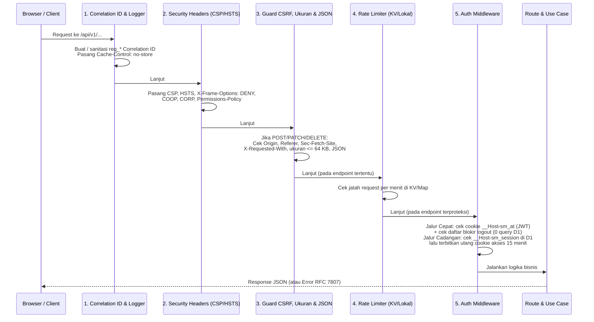

# Arsitektur Sistem — Stock-Mate v2 (Bahasa Indonesia)

> **Kembali ke Panduan Utama:** [docs/id/README.md](README.md)  
> **Versi Inggris:** [docs/architecture.md](../architecture.md) · **ADR Skalabilitas:** [ADR-001](../ADR-001-100k-scaling-architecture.md)

---

## 1. Gaya Arsitektur Secara Sederhana

Stock-Mate v2 dibangun dengan gaya **Modular Monolith yang Stateless di Edge (Cloudflare Workers)**. Artinya:
- **Satu proyek terpadu** untuk frontend (React 19 SPA) dan backend API (Hono), dideploy bersamaan dalam satu Cloudflare Worker.
- **Tanpa state di memori server yang wajib diingat** (*stateless*): tidak peduli request user mendarat di server Cloudflare Jakarta, Singapura, atau Tokyo, hasilnya tetap konsisten karena data disimpan di D1 dan KV.
- **Hexagonal / Clean Architecture:** Di folder `src/server/modules/`, setiap modul (`auth`, `watchlist`, `market-data`) dibagi menjadi 3 lapisan rapi:
  - `domain/` — kontrak interface dan tipe inti (tidak tahu soal SQLite atau HTTP).
  - `application/` — alur bisnis (*Use Case*), misalnya "tambah saham ke watchlist", "sinkronisasi katalog".
  - `infra/` — implementasi teknis (route HTTP Hono, query Drizzle D1, adapter TradingView/Yahoo).
- **Domain Isomorfik (`src/shared/`):** Rumus finansial dan validasi Zod ditulis sekali lalu dipakai oleh **backend sekaligus frontend**. Jadi hitungan Harga Wajar di server pasti 100% identik dengan simulasi *What-If* di browser.

---

## 2. Alur Request & Middleware API

Setiap kali browser memanggil `/api/v1/*`, request melewati 5 pos penjagaan berurutan di [`src/server/index.ts`](../../src/server/index.ts):

---

## 3. Strategi Caching 4 Lapis (Kunci Kecepatan)

Agar ~900 saham IHSG bisa diakses ribuan user bersamaan tanpa bikin database D1 penuh atau diblokir TradingView, katalog saham disimpan dalam **4 lapisan cache** ([`catalog-snapshot-store.ts`](../../src/server/modules/watchlist/infra/catalog-snapshot-store.ts)):

| Lapisan | Lokasi | Masa Berlaku | Cara Kerja |
| :---: | :--- | :--- | :--- |
| **L1** | **Cloudflare Edge Cache** (`caches.default`) | `max-age=60s`, `s-maxage=120s`, `SWR=300s` | Melayani `GET /api/v1/catalog/snapshot` langsung dari server terdekat user (termasuk respon `304 Not Modified` jika `ETag` sama). **0 hit ke Worker/D1.** |
| **L2** | **Hot Cache Memori Worker** (`hotSnapshot`) | `30 detik` | Menyimpan snapshot di RAM isolate Worker; jika ada puluhan request masuk bersamaan saat cache kosong, semuanya digabung jadi 1 tarikan (*single-flight coalescing*). |
| **L3** | **Cloudflare KV** (`catalog:v3:latest`) | `12 jam` | Menyimpan JSON snapshot yang **sudah dihitung** valuasi Core-3 dan FQS v2-nya. Membaca dari KV = **0 query D1**. |
| **L4** | **Cloudflare D1** (`idx_stocks`) | Permanen (sumber utama) | Dipakai hanya jika KV belum aktif/kosong, lalu otomatis mengisi ulang KV. |

**Fitur Self-Healing (SWR):** Saat `GET /api/v1/catalog/snapshot` mendeteksi snapshot sudah berumur `≥ 5 menit`, belum punya `openPrice`, atau belum ada saham sektor `PROPERTY_REAL_ESTATE`, Worker tetap langsung membalas user dengan data yang ada, sambil diam-diam menyegarkan data di latar belakang (`waitUntil`) dengan kunci KV `catalog:sync:lock` (TTL 240 detik).

---

## 4. Arsitektur Frontend (React 19 SPA)

Di [`src/client/App.tsx`](../../src/client/App.tsx), aplikasi dibungkus bertingkat oleh:
1. **`ErrorBoundary`** — menangkap error render tak terduga agar layar tidak putih polos, menampilkan pesan pemulihan dwibahasa tanpa membocorkan data sensitif.
2. **`ThemeProvider`** — mode Terang/Gelap (`stockmate-theme`), dibantu [`public/theme-init.js`](../../public/theme-init.js) sebelum halaman digambar supaya tidak berkedip putih.
3. **`QueryClientProvider`** — TanStack Query untuk cache API & auto-refresh tiap 3 menit saat tab aktif.
4. **`I18nProvider`** — memuat kamus `en.ts` atau `id.ts` secara *lazy* sesuai pilihan user/browser.
5. **`PrivacyProvider`** — fitur sensor angka Rupiah (`Rp •••••••`) dan lot (`•••`).
6. **`CalcModeProvider`** — pilihan tampilan P/L `BROKER_GROSS` (default di UI) vs `NET_AFTER_FEES`.
7. **`ToastProvider`** — notifikasi mengambang saat simpan/sync berhasil atau gagal.

Semua 6 halaman utama dan 3 tab sekunder simulator di-*lazy load* (`React.lazy`), dan vendor library dipecah di [`vite.config.ts`](../../vite.config.ts) (`react-vendor`, `query-vendor`, `icons-vendor`, `validation-vendor`) supaya bundel awal tetap sangat ringan (`<= 250 kB` raw).

---

## 5. Pilihan Trade-Off (CAP Theorem) & Ketahanan Sistem

- **Katalog IHSG (Utamakan Ketersediaan / AP):** Tidak masalah harga terlambat 1–5 menit selama halaman selalu terbuka cepat (<200ms) dan tidak tumbang saat jam buka bursa.
- **Portofolio & Watchlist Pribadi (Utamakan Konsistensi / CP):** Jumlah lot dan harga beli harus selalu akurat seketika (*strong consistency*), sehingga memakai transaksi batch ACID di D1.
- **Autentikasi (Hybrid Cepat + Bisa Dicabut):** Verifikasi JWT 15 menit menghilangkan ~95% query DB, sementara logout langsung memblokir token tersebut via daftar blokir KV (`revoked:sid:*`).
- **Circuit Breaker ([`circuit-breaker.ts`](../../src/server/shared/resilience/circuit-breaker.ts)):** Jika TradingView atau Yahoo Finance gagal 3 kali berturut-turut, pemutus arus terbuka 60 detik agar user tidak menunggu timeout panjang dan langsung diarahkan ke provider cadangan / input manual.

---

## 6. Tahapan Skalabilitas (Roadmap ADR-001)

1. **Fase A (Aktif Saat Ini — 0 s.d. ~20.000 user bersamaan):** 1 D1 primary + `STOCK_MATE_KV` + Cron Trigger + Edge Cache.
2. **Fase B (20.000 – 100.000 user):** Aktifkan Cloudflare D1 Read Replicas + Cloudflare WAF Rate Limiting.
3. **Fase C (> 100.000 user / > 2.500 write/detik):** Pindahkan tabel transaksi user ke PostgreSQL via Cloudflare Hyperdrive, sementara katalog IHSG tetap di KV + Edge Cache.
