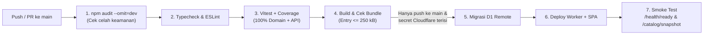

# Panduan Build, CI/CD & Deploy — Stock-Mate v2 (Bahasa Indonesia)

> **Kembali ke Panduan Utama:** [docs/id/README.md](README.md)  
> **Versi Inggris:** [docs/deployment-guide.md](../deployment-guide.md)  
> **Workflow CI/CD:** [`.github/workflows/ci.yml`](../../.github/workflows/ci.yml) · **Konfigurasi Worker:** [`wrangler.jsonc`](../../wrangler.jsonc)

---

## 1. Gambaran Topologi Deploy

Seluruh aplikasi (React SPA + Backend API Hono + Cron Trigger) dideploy sebagai **1 Cloudflare Worker** bernama `stock-mate-v2`:
- **URL Produksi:** `https://stock-mate-v2.charlymicolas21.workers.dev`
- **Database:** Cloudflare D1 (`stock-mate-db`)
- **Edge KV:** `STOCK_MATE_KV`
- **Observability:** Aktif (`"observability": { "enabled": true }`)

---

## 2. Setup Awal di Akun Cloudflare Baru

Jika ingin deploy ke akun Cloudflare baru atau environment staging terpisah:

```bash
# 1. Login Wrangler
npx wrangler login

# 2. Buat database D1 & KV namespace
npx wrangler d1 create stock-mate-db
npx wrangler kv namespace create STOCK_MATE_KV
npx wrangler kv namespace create STOCK_MATE_KV --preview

# 3. Masukkan ID yang muncul ke file wrangler.jsonc

# 4. Pasang secret produksi (JANGAN pernah commit ke Git!)
npx wrangler secret put JWT_SECRET          # String acak minimal 32 byte untuk JWT 15 menit
npx wrangler secret put CATALOG_SYNC_SECRET # Token rahasia admin untuk sync katalog manual
```

---

## 3. Alur CI/CD Otomatis (GitHub Actions)

Setiap kali ada **Pull Request** atau **Push ke branch `main`**, [`.github/workflows/ci.yml`](../../.github/workflows/ci.yml) menjalankan tahapan berikut secara berurutan di **Node.js 24**:



**Secret GitHub Repository yang dibutuhkan agar CD berjalan otomatis:**
- `CLOUDFLARE_API_TOKEN`
- `CLOUDFLARE_ACCOUNT_ID`

*(Jika belum dipasang di GitHub Secrets, tahap deploy akan dilewati secara aman tanpa membuat CI merah.)*

---

## 4. Cara Deploy Manual dari Komputer Lokal

```bash
# 1. Pastikan semua pengecekan kualitas lolos
npm audit --omit=dev --audit-level=high
npm run typecheck
npm run lint
npm run test:coverage
npm run build
npm run check:bundle

# 2. Jalankan migrasi SQL terbaru ke database produksi (D1 remote)
npm run db:migrate:remote

# 3. Build & deploy ke Cloudflare Workers
npm run deploy
```

> **Aturan Emas Migrasi:** Selalu jalankan `db:migrate:remote` **sebelum** `wrangler deploy` agar kolom baru sudah tersedia sebelum kode baru menerima trafik.

---

## 5. Verifikasi Setelah Deploy & Rollback

### Cek Cepat Pasca-Deploy
```bash
curl --fail https://stock-mate-v2.charlymicolas21.workers.dev/api/v1/health/live
curl --fail https://stock-mate-v2.charlymicolas21.workers.dev/api/v1/health/ready
curl -i https://stock-mate-v2.charlymicolas21.workers.dev/api/v1/catalog/snapshot | head -n 15
```

### Rollback Jika Ada Masalah di Produksi
- **Rollback Aplikasi (Worker + SPA):**
  ```bash
  npx wrangler deployments list
  npx wrangler rollback
  ```
- **Rollback Database:** Migrasi `0001`–`0007` bersifat *additive* (menambah tabel/kolom tanpa menghapus kolom lama), sehingga rollback kode aplikasi ke versi sebelumnya umumnya tetap kompatibel. Untuk pemulihan data darurat, gunakan fitur *Cloudflare D1 Time Travel* di dashboard Cloudflare (*batas retensi tergantung paket Cloudflare*).
