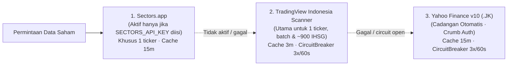

# Panduan Integrasi Sistem — Stock-Mate v2 (Bahasa Indonesia)

> **Kembali ke Panduan Utama:** [docs/id/README.md](README.md)  
> **Versi Inggris:** [docs/integration-guide.md](../integration-guide.md)

---

## 1. Rantai Provider Data Saham (Fallback Otomatis)

Stock-Mate v2 membungkus sumber data pasar lewat [`CompositeIdxMarketDataProvider`](../../src/server/modules/market-data/infra/sectors-provider.ts#L267-L317) agar sistem tidak bergantung pada satu layanan saja:

---

## 2. TradingView Indonesia Scanner (Sumber Utama)

File: [`src/server/modules/market-data/infra/tradingview-provider.ts`](../../src/server/modules/market-data/infra/tradingview-provider.ts)

- **Endpoint:** `POST https://scanner.tradingview.com/indonesia/scan` (tanpa API key).
- **Timeout:** `8 detik` (1/batch ticker) dan `15 detik` (scan seluruh IHSG).
- **Filter Scan IHSG:** Hanya mengambil `exchange = IDX`, `type = stock`, `subtype = common`, `is_primary = true`, `active_symbol = true`, `market_cap_basic > 0`, `close > 0`, dan ticker persis **4 huruf** (`/^[A-Z]{4}$/` — waran, right, obligasi, dan ETF otomatis dibuang).
- **33 Kolom Data:** Mengambil harga penutupan, harga pembukaan (`open`), perubahan harian (`change_abs`, `change`), EPS, BVPS, DPS, ROE, DER, pertumbuhan EPS/Revenue/Net Income, Market Cap, volume rata-rata 30 hari, ROA, ROIC, margin, Current Ratio, Net Debt, EBITDA, aset/liabilitas, CFO, FCF, Piotroski F-Score, Altman Z-Score, dan `industry`.
- **Pengolahan Penting Saat Parsing:**
  - `adtvIdr = average_volume_30d_calc × close` (rata-rata nilai transaksi harian 30 hari).
  - `equityToAssetsPct = ((Total Assets − Total Liabilities) / Total Assets) × 100`.
  - **Koreksi Sektor Properti:** Karena TradingView menaruh properti di bawah `Finance`, parser mengecek kolom `industry` lebih dulu supaya emiten properti/REIT masuk ke `PROPERTY_REAL_ESTATE` (bukan `FINANCIALS`).
  - **Aturan Perbankan:** Emiten `FINANCIALS` dikosongkan `der` dan `currentRatio`-nya, lalu nilai `debt_to_equity` dipindahkan ke `wholesaleDer`.

---

## 3. Yahoo Finance v10 (Cadangan Otomatis)

File: [`src/server/modules/market-data/infra/yahoo-finance-provider.ts`](../../src/server/modules/market-data/infra/yahoo-finance-provider.ts)

- **Cara Kerja Autentikasi Otomatis:**
  1. Memanggil `https://fc.yahoo.com` untuk mengambil cookie sesi.
  2. Menukar cookie ke `https://query2.finance.yahoo.com/v1/test/getcrumb` untuk memperoleh `crumb` (disimpan di cache isolate 25 menit; otomatis diulang 1x jika dapat `401`/`403`).
  3. Memanggil `quoteSummary/{TICKER}.JK` untuk modul `price,summaryDetail,defaultKeyStatistics,financialData,assetProfile`.
- **Penyesuaian Data:** Membagi `debtToEquity` Yahoo dengan `100` (karena Yahoo memakai format persen, misal `64.97` → `0.65x`), dan melindungi dari bug `trailingEps` positif palsu saat Net Income/ROE sebenarnya negatif.

---

## 4. Sectors.app API (Opsional)

File: [`src/server/modules/market-data/infra/sectors-provider.ts`](../../src/server/modules/market-data/infra/sectors-provider.ts)

- Hanya aktif jika secret `SECTORS_API_KEY` dipasang di Cloudflare Worker.
- Keunggulannya: mengambil rata-rata P/E dan P/B kompetitor (`pe_peer_avg`, `pb_peer_avg`) untuk mengisi `targetPer` dan `targetPbv`.
- Keterbatasannya: belum mendukung batch/full-universe scan dan belum mengisi 19 metrik FQS lanjutan.

---

## 5. Integrasi Platform Cloudflare & Client API

- **Cloudflare Bindings (`wrangler.jsonc`):** `DB` (D1 `stock-mate-db`), `STOCK_MATE_KV` (KV namespace), `caches.default` (Edge Cache).
- **Client HTTP Wrapper ([`apiClient.ts`](../../src/client/lib/apiClient.ts)):** Semua panggilan dari React otomatis menyertakan `credentials: 'include'` (mengirim cookie `HttpOnly`) dan header `X-Requested-With: StockMate` (bukti same-origin CSRF), serta mengubah response RFC 7807 menjadi `ApiClientError`.
- **Font Eksternal (`index.html`):** Menggunakan Google Fonts (`Inter`, `Plus Jakarta Sans`, `JetBrains Mono`) yang sudah diizinkan eksplisit pada header CSP.
