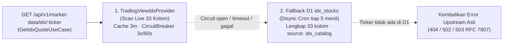

# Panduan Integrasi Sistem — Stock-Mate v2 (Bahasa Indonesia)

> **Kembali ke Panduan Utama:** [docs/id/README.md](README.md)  
> **Versi Inggris:** [docs/integration-guide.md](../integration-guide.md)

---

## 1. Arsitektur Sumber Data & Fallback D1 `idx_stocks`

Stock-Mate v2 menggunakan **TradingView Indonesia Scanner** sebagai **satu-satunya sumber data pasar live** (agar seluruh 33 kolom Core-3 + FQS v2 + harga intraday 100% seragam), dilengkapi **fallback otomatis ke tabel D1 `idx_stocks`** untuk endpoint pencarian 1 ticker (`GET /api/v1/market-data/idx/:ticker`):

---

## 2. TradingView Indonesia Scanner (Sumber Data Utama)

File: [`src/server/modules/market-data/infra/tradingview-provider.ts`](../../src/server/modules/market-data/infra/tradingview-provider.ts)

- **Endpoint:** `POST https://scanner.tradingview.com/indonesia/scan` (tanpa API key).
- **Timeout:** `8 detik` (1/batch ticker) dan `15 detik` (scan seluruh IHSG).
- **Circuit Breaker:** `CircuitBreaker(3, 60_000)` — otomatis jeda 60 detik jika gagal 3x berturut-turut.
- **Cache Memori:** `BoundedTtlCache` TTL `3 menit`, maks. `500` ticker.
- **Filter Scan IHSG:** Hanya mengambil `exchange = IDX`, `type = stock`, `subtype = common`, `is_primary = true`, `active_symbol = true`, `market_cap_basic > 0`, `close > 0`, dan ticker persis **4 huruf** (`/^[A-Z]{4}$/` — waran, right, obligasi, dan ETF otomatis dibuang).
- **33 Kolom Data:** Harga penutupan, harga pembukaan (`open`), perubahan harian (`change_abs`, `change`), EPS, BVPS, DPS, ROE, DER, pertumbuhan EPS/Revenue/Net Income, Market Cap, volume rata-rata 30 hari, ROA, ROIC, margin, Current Ratio, Net Debt, EBITDA, aset/liabilitas, CFO, FCF, Piotroski F-Score, Altman Z-Score, dan `industry`.
- **Pengolahan Penting Saat Parsing:**
  - `adtvIdr = average_volume_30d_calc × close` (rata-rata nilai transaksi harian 30 hari).
  - `equityToAssetsPct = ((Total Assets − Total Liabilities) / Total Assets) × 100`.
  - **Koreksi Sektor Properti:** Karena TradingView menaruh properti di bawah `Finance`, parser mengecek kolom `industry` lebih dulu di `mapMarketSectorToIdx()` supaya emiten properti/REIT masuk ke `PROPERTY_REAL_ESTATE` (bukan `FINANCIALS`).
  - **Aturan Perbankan:** Emiten `FINANCIALS` dikosongkan `der` dan `currentRatio`-nya, lalu nilai `debt_to_equity` dipindahkan ke `wholesaleDer`.

---

## 3. Fallback D1 `idx_stocks` (`GetIdxQuoteUseCase`)

File: [`src/server/modules/market-data/application/get-idx-quote-use-case.ts`](../../src/server/modules/market-data/application/get-idx-quote-use-case.ts)

Saat TradingView gagal atau *circuit breaker*-nya terbuka:
1. Sistem mencari ticker tersebut langsung di tabel D1 `idx_stocks` (yang disegarkan Cron tiap 5 menit selama jam bursa).
2. Jika ada, seluruh 33 kolom (harga, open, perubahan harian, Core-3, dan 19 metrik FQS) dikembalikan utuh dengan `source: 'idx_catalog'` dan `fetchedAt` sesuai waktu sinkronisasi terakhir.
3. Jika ticker memang tidak ada di `idx_stocks`, error upstream asli (`404`/`502`/`503`) tetap diteruskan dalam format RFC 7807.

---

## 4. Integrasi Platform Cloudflare & Client API

- **Cloudflare Bindings (`wrangler.jsonc`):** `DB` (D1 `stock-mate-db`), `STOCK_MATE_KV` (KV namespace), `caches.default` (Edge Cache).
- **Client HTTP Wrapper ([`apiClient.ts`](../../src/client/lib/apiClient.ts)):** Semua panggilan dari React otomatis menyertakan `credentials: 'include'` (mengirim cookie `HttpOnly`) dan header `X-Requested-With: StockMate` (bukti same-origin CSRF), serta mengubah response RFC 7807 menjadi `ApiClientError`.
- **Font Eksternal (`index.html`):** Menggunakan Google Fonts (`Inter`, `Plus Jakarta Sans`, `JetBrains Mono`) yang sudah diizinkan eksplisit pada header CSP.
