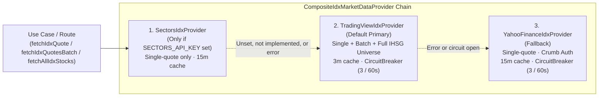

# Integration Guide — Stock-Mate v2

> **Document Type:** As-Built Internal & External Integration Reference  
> **Parent Document:** [README.md](../README.md)  
> **Module Source:** [`src/server/modules/market-data/`](../src/server/modules/market-data/)

---

## Table of Contents

1. [External Provider Chain & Fallback Topology](#1-external-provider-chain--fallback-topology)
2. [TradingView Indonesia Scanner Integration](#2-tradingview-indonesia-scanner-integration)
3. [Yahoo Finance v10 QuoteSummary Integration](#3-yahoo-finance-v10-quotesummary-integration)
4. [Sectors.app Company Report Integration (Optional)](#4-sectorsapp-company-report-integration-optional)
5. [Cloudflare Platform Bindings](#5-cloudflare-platform-bindings)
6. [Frontend-to-Backend API Client Integration](#6-frontend-to-backend-api-client-integration)
7. [External Fonts & Static Asset Dependencies](#7-external-fonts--static-asset-dependencies)

---

## 1. External Provider Chain & Fallback Topology

Stock-Mate v2 abstracts all external market data behind the [`IdxMarketDataProvider`](../src/server/modules/market-data/domain/market-data.types.ts) port interface and composes adapters using [`CompositeIdxMarketDataProvider`](../src/server/modules/market-data/infra/sectors-provider.ts#L267-L317).

### Capability Matrix

| Operation | `SectorsIdxProvider` | `TradingViewIdxProvider` | `YahooFinanceIdxProvider` |
| :--- | :---: | :---: | :---: |
| `fetchIdxQuote(ticker)` | Supported | Supported (via 1-ticker batch) | Supported |
| `fetchIdxQuotesBatch(tickers)` | Not implemented (delegates to fallback) | Supported (single POST) | Not implemented (sequential loop fallback) |
| `fetchAllIdxStocks()` | Not implemented (delegates to fallback) | Supported (full IHSG universe scan) | Not implemented |
| Extended 19 FQS Metrics | No (core valuation only) | Full 33-column scan (including Piotroski & Altman Z) | Partial (no ROIC, Equity/Assets, Piotroski, Altman Z) |
| Intraday `openPrice` & `dailyChange` | No | Yes | Yes |
| Circuit Breaker | None | `CircuitBreaker(3, 60_000)` | `CircuitBreaker(3, 60_000)` (ignores `404`) |

---

## 2. TradingView Indonesia Scanner Integration

Source: [`src/server/modules/market-data/infra/tradingview-provider.ts`](../src/server/modules/market-data/infra/tradingview-provider.ts)

- **Endpoint:** `POST https://scanner.tradingview.com/indonesia/scan`
- **Authentication:** Unauthenticated public scanner endpoint (`Content-Type: application/json`).
- **Timeouts:** `8,000 ms` for single/batch symbol lookups; `15,000 ms` for full IHSG universe scans.
- **In-Isolate Cache:** `BoundedTtlCache` — `3 minutes` TTL, max `500` entries.
- **Universe Scan Filter (`fetchAllIdxStocks`):**
  - `exchange == "IDX"`, `type == "stock"`, `subtype == "common"`, `is_primary == true`, `active_symbol == true`, `market_cap_basic > 0`, `close > 0`.
  - Range `[0, 1500]` sorted by `market_cap_basic desc`.
  - Post-filtered strictly to 4-letter tickers (`/^[A-Z]{4}$/`), excluding warrants, rights, bonds, and ETFs.
- **33 Positional Columns Requested:** Core price/company (`name`, `description`, `close`, `sector`), valuation (`earnings_per_share_basic_ttm`, `book_value_per_share_fq`, `dps_common_stock_prim_issue_fy`, `return_on_equity`, `debt_to_equity`, `earnings_per_share_diluted_yoy_growth_ttm`), 19 FQS/liquidity fields (`market_cap_basic`, `average_volume_30d_calc`, `return_on_assets`, `return_on_invested_capital`, `operating_margin`, `net_margin`, `total_revenue_yoy_growth_ttm`, `net_income_yoy_growth_ttm`, `current_ratio`, `net_debt`, `ebitda`, `total_assets_fq`, `total_liabilities_fq`, `cash_f_operating_activities_ttm`, `free_cash_flow_ttm`, `net_income_ttm`, `free_cash_flow_margin_ttm`, `piotroski_f_score_ttm`, `altman_z_score_ttm`), plus intraday & industry (`open`, `change_abs`, `change`, `industry`).
- **Derived Calculations During Parsing (`parseTradingViewRowToDto`):**
  - `adtvIdr = Math.round(average_volume_30d_calc * close)`
  - `equityToAssetsPct = ((total_assets_fq - total_liabilities_fq) / total_assets_fq) * 100`
  - `cfoToNetIncome = cfo / net_income_ttm` (when `net_income_ttm > 0`)
  - `fcfYieldPct = (free_cash_flow_ttm / market_cap_basic) * 100`
  - `netDebtToEbitda`: Computed for non-financials; negative net debt yields clamped negative ratio (or `-0.01` when EBITDA `<= 0`), positive net debt with EBITDA `<= 0` clamps to `50`.
  - **Banking Rule:** When mapped sector is `FINANCIALS`, `der` and `currentRatio` are forced to `null` and `debt_to_equity` is stored in `wholesaleDer`.
  - **Property Sector Override:** `industry` is passed into `mapYahooSectorToIdx()` and checked **before** `sector` so Indonesian property developers nested under TradingView's `Finance` sector are correctly classified as `PROPERTY_REAL_ESTATE`.

---

## 3. Yahoo Finance v10 QuoteSummary Integration

Source: [`src/server/modules/market-data/infra/yahoo-finance-provider.ts`](../src/server/modules/market-data/infra/yahoo-finance-provider.ts)

- **Endpoints:**
  1. Cookie handshake: `GET https://fc.yahoo.com` (`redirect: 'manual'`)
  2. Crumb exchange: `GET https://query2.finance.yahoo.com/v1/test/getcrumb`
  3. Quote query: `GET https://query2.finance.yahoo.com/v10/finance/quoteSummary/{TICKER}.JK?modules=price,summaryDetail,defaultKeyStatistics,financialData,assetProfile&crumb={CRUMB}`
- **Session Management:** Caches `{ cookie, crumb }` per isolate for `25 minutes` (`CRUMB_TTL_MS`). Automatically refreshes crumb and retries once on HTTP `401` or `403`.
- **In-Isolate Cache:** `BoundedTtlCache` — `15 minutes` TTL, max `500` entries.
- **Data Normalization Safeguards:**
  - Converts Yahoo's percentage-based `debtToEquity` (e.g., `64.97`) to ratio (`0.65x`) by dividing by `100`.
  - Guards against stale positive `trailingEps` contradicting negative `netIncomeToCommon / sharesOutstanding` or negative ROE.
  - Multiplies decimal ratios (`returnOnEquity`, `operatingMargins`, `revenueGrowth`, etc.) by `100` into percentages.

---

## 4. Sectors.app Company Report Integration (Optional)

Source: [`src/server/modules/market-data/infra/sectors-provider.ts`](../src/server/modules/market-data/infra/sectors-provider.ts)

- **Activation:** Activated automatically when the Cloudflare secret `SECTORS_API_KEY` is present in `AppBindings`.
- **Endpoint:** `GET https://api.sectors.app/v1/company/report/{TICKER}/?sections=overview,valuation,financials,dividend`
- **Authentication:** `Authorization: <SECTORS_API_KEY>` header.
- **Unique Behavior:** Extracts peer-average multiples (`pe_peer_avg`, `pb_peer_avg`) as `targetPer` / `targetPbv` (falling back to static `SECTOR_BENCHMARK_MULTIPLES` when absent or out of range). Derives EPS from `Price / PE`, BVPS from `Price / PB`, DER from `total_debt / total_equity`, and DPS from `yield_ttm` when direct fields are absent.

---

## 5. Cloudflare Platform Bindings

Defined in [`wrangler.jsonc`](../wrangler.jsonc) and typed in [`src/server/shared/types.ts`](../src/server/shared/types.ts):

| Binding Name | Cloudflare Service | Required? | Purpose |
| :--- | :--- | :---: | :--- |
| `DB` | Cloudflare D1 (`stock-mate-db`) | **Yes** | Primary relational SQLite database for users, sessions, personal watchlists, custom watchlists, and `idx_stocks`. |
| `STOCK_MATE_KV` | Cloudflare KV | Optional (Recommended in Prod) | Stores precomputed IHSG catalog snapshot, SWR sync lock, session revocations, and distributed rate-limit counters. |
| `JWT_SECRET` | Worker Secret | Optional (Required for Multi-PoP Prod) | HMAC-SHA256 signing key (≥16 chars; recommended ≥32 random bytes) for 15m `__Host-sm_at` fast-path tokens. Falls back to ephemeral per-isolate key when unset. |
| `CATALOG_SYNC_SECRET` | Worker Secret | Optional (Recommended in Prod) | Restricts `POST /api/v1/watchlist/catalog/sync` to `Authorization: Bearer <secret>`. |
| `SECTORS_API_KEY` | Worker Secret | Optional | Enables `SectorsIdxProvider` as primary single-quote source ahead of TradingView. |
| `caches.default` | Cloudflare Edge Cache API | Runtime-provided | Caches `GET /api/v1/catalog/snapshot` at Cloudflare PoPs. |

---

## 6. Frontend-to-Backend API Client Integration

Source: [`src/client/lib/apiClient.ts`](../src/client/lib/apiClient.ts)

- All client HTTP requests pass through `apiRequest<T>(path, options)`:
  - Automatically attaches `credentials: 'include'` so `HttpOnly` cookies are sent.
  - Always sets `X-Requested-With: StockMate` to satisfy the server's same-origin CSRF proof.
  - Sets `Content-Type: application/json` whenever a request body is present.
  - Parses both `application/json` and `application/problem+json`, throwing structured `ApiClientError(status, detail, problem)` on non-2xx responses.
  - Handles `204 No Content` without attempting JSON parsing.

---

## 7. External Fonts & Static Asset Dependencies

In [`index.html`](../index.html) and permitted explicitly by the Content Security Policy in [`public/_headers`](../public/_headers) and [`src/server/index.ts`](../src/server/index.ts):
- **Google Fonts (`https://fonts.googleapis.com`, `https://fonts.gstatic.com`):** Loads `Inter`, `Plus Jakarta Sans`, and `JetBrains Mono` (used for tabular financial figures via `.tabular-nums`).
- **Pre-Paint Theme Script:** [`public/theme-init.js`](../public/theme-init.js) is loaded synchronously from `'self'` (no inline `<script>` needed, keeping `script-src 'self'` strict without `'unsafe-inline'`).
