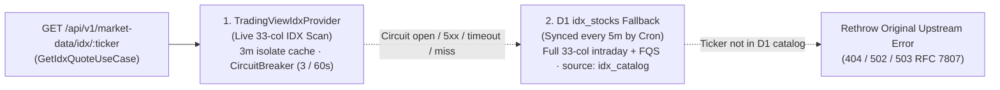

# Integration Guide — Stock-Mate v2

> **Document Type:** As-Built Internal & External Integration Reference  
> **Parent Document:** [README.md](../README.md)  
> **Module Source:** [`src/server/modules/market-data/`](../src/server/modules/market-data/)

---

## Table of Contents

1. [Market Data Architecture & D1 Fallback Flow](#1-market-data-architecture--d1-fallback-flow)
2. [TradingView Indonesia Scanner Integration](#2-tradingview-indonesia-scanner-integration)
3. [D1 `idx_stocks` Catalog Fallback (`GetIdxQuoteUseCase`)](#3-d1-idx_stocks-catalog-fallback-getidxquoteusecase)
4. [Cloudflare Platform Bindings](#4-cloudflare-platform-bindings)
5. [Frontend-to-Backend API Client Integration](#5-frontend-to-backend-api-client-integration)
6. [External Fonts & Static Asset Dependencies](#6-external-fonts--static-asset-dependencies)

---

## 1. Market Data Architecture & D1 Fallback Flow

Stock-Mate v2 uses **TradingView Indonesia Scanner** as its sole live external market-data source (guaranteeing 100% consistent 33-column Core-3 + FQS v2 + intraday coverage), paired with an automatic **Cloudflare D1 `idx_stocks` fallback** for single-ticker quote requests (`GET /api/v1/market-data/idx/:ticker`).

---

## 2. TradingView Indonesia Scanner Integration

Source: [`src/server/modules/market-data/infra/tradingview-provider.ts`](../src/server/modules/market-data/infra/tradingview-provider.ts)

- **Endpoint:** `POST https://scanner.tradingview.com/indonesia/scan`
- **Authentication:** Unauthenticated public scanner endpoint (`Content-Type: application/json`).
- **Timeouts:** `8,000 ms` for single/batch symbol lookups; `15,000 ms` for full IHSG universe scans.
- **Circuit Breaker:** `CircuitBreaker(3, 60_000)` — opens for 60 seconds after 3 consecutive upstream failures.
- **In-Isolate Cache:** `BoundedTtlCache` — `3 minutes` TTL, max `500` entries.
- **Universe Scan Filter (`fetchAllIdxStocks`):**
  - `exchange == "IDX"`, `type == "stock"`, `subtype == "common"`, `is_primary == true`, `active_symbol == true`, `market_cap_basic > 0`, `close > 0`.
  - Range `[0, 1500]` sorted by `market_cap_basic desc`.
  - Post-filtered strictly to 4-letter tickers (`/^[A-Z]{4}$/`), excluding warrants, rights, bonds, and ETFs.
- **33 Positional Columns Requested:** Core price/company (`name`, `description`, `close`, `sector`), valuation (`earnings_per_share_basic_ttm`, `book_value_per_share_fq`, `dps_common_stock_prim_issue_fy`, `return_on_equity`, `debt_to_equity`, `earnings_per_share_diluted_yoy_growth_ttm`), 19 FQS/liquidity fields (`market_cap_basic`, `average_volume_30d_calc`, `return_on_assets`, `return_on_invested_capital`, `operating_margin`, `net_margin`, `total_revenue_yoy_growth_ttm`, `net_income_yoy_growth_ttm`, `current_ratio`, `net_debt`, `ebitda`, `total_assets_fq`, `total_liabilities_fq`, `cash_f_operating_activities_ttm`, `free_cash_flow_ttm`, `net_income_ttm`, `free_cash_flow_margin_ttm`, `piotroski_f_score_ttm`, `altman_z_score_ttm`), plus intraday & industry (`open`, `change_abs`, `change`, `industry`).
- **Derived Calculations During Parsing (`parseTradingViewRowToDto`):**
  - `adtvIdr = Math.round(average_volume_30d_calc * close)`
  - `equityToAssetsPct = ((total_assets_fq - total_liabilities_fq) / total_assets_fq) * 100`
  - `cfoToNetIncome = cfo / net_income_ttm` (when `net_income_ttm > 0`)
  - `fcfYieldPct = (free_cash_flow_ttm / market_cap_basic) * 100`
  - `netDebtToEbitda`: Computed for non-financials; negative net debt yields clamped negative ratio (or `-0.01` when EBITDA `<= 0`), positive net debt with EBITDA `<= 0` clamps to `50`.
  - **Banking Rule:** When mapped sector is `FINANCIALS`, `der` and `currentRatio` are forced to `null` and `debt_to_equity` is stored in `wholesaleDer`.
  - **Property Sector Override:** `industry` is passed into `mapMarketSectorToIdx()` and checked **before** `sector` so Indonesian property developers nested under TradingView's `Finance` sector are correctly classified as `PROPERTY_REAL_ESTATE`.

---

## 3. D1 `idx_stocks` Catalog Fallback (`GetIdxQuoteUseCase`)

Source: [`src/server/modules/market-data/application/get-idx-quote-use-case.ts`](../src/server/modules/market-data/application/get-idx-quote-use-case.ts)

When `GET /api/v1/market-data/idx/:ticker` encounters a TradingView error (network timeout, `502`, or `503` circuit breaker open):
1. `GetIdxQuoteUseCase` queries `idxCatalogRepo.findByTicker(ticker)` (primary-key `O(1)` lookup on D1 `idx_stocks`, refreshed every 5 minutes during IDX hours by Cloudflare Cron).
2. If found, `mapIdxStockRecordToQuoteDto()` converts the persisted row into a full `IdxMarketQuoteDto` preserving all intraday fields (`openPrice`, `dailyChange`, `dailyChangePct`) and all 19 FQS metrics, setting `source: 'idx_catalog'` and `fetchedAt` to the row's `syncedAt` ISO timestamp.
3. If the ticker does not exist in `idx_stocks` (or D1 itself fails), the original upstream error is rethrown unchanged as an RFC 7807 response.

---

## 4. Cloudflare Platform Bindings

Defined in [`wrangler.jsonc`](../wrangler.jsonc) and typed in [`src/server/shared/types.ts`](../src/server/shared/types.ts):

| Binding Name | Cloudflare Service | Required? | Purpose |
| :--- | :--- | :---: | :--- |
| `DB` | Cloudflare D1 (`stock-mate-db`) | **Yes** | Primary relational SQLite database for users, sessions, personal watchlists, custom watchlists, and `idx_stocks`. |
| `STOCK_MATE_KV` | Cloudflare KV | Optional (Recommended in Prod) | Stores precomputed IHSG catalog snapshot, SWR sync lock, session revocations, and distributed rate-limit counters. |
| `JWT_SECRET` | Worker Secret | Optional (Required for Multi-PoP Prod) | HMAC-SHA256 signing key (≥16 chars; recommended ≥32 random bytes) for 15m `__Host-sm_at` fast-path tokens. Falls back to ephemeral per-isolate key when unset. |
| `CATALOG_SYNC_SECRET` | Worker Secret | Optional (Recommended in Prod) | Restricts `POST /api/v1/watchlist/catalog/sync` to `Authorization: Bearer <secret>`. |
| `caches.default` | Cloudflare Edge Cache API | Runtime-provided | Caches `GET /api/v1/catalog/snapshot` at Cloudflare PoPs. |

---

## 5. Frontend-to-Backend API Client Integration

Source: [`src/client/lib/apiClient.ts`](../src/client/lib/apiClient.ts)

- All client HTTP requests pass through `apiRequest<T>(path, options)`:
  - Automatically attaches `credentials: 'include'` so `HttpOnly` cookies are sent.
  - Always sets `X-Requested-With: StockMate` to satisfy the server's same-origin CSRF proof.
  - Sets `Content-Type: application/json` whenever a request body is present.
  - Parses both `application/json` and `application/problem+json`, throwing structured `ApiClientError(status, detail, problem)` on non-2xx responses.
  - Handles `204 No Content` without attempting JSON parsing.

---

## 6. External Fonts & Static Asset Dependencies

In [`index.html`](../index.html) and permitted explicitly by the Content Security Policy in [`public/_headers`](../public/_headers) and [`src/server/index.ts`](../src/server/index.ts):
- **Google Fonts (`https://fonts.googleapis.com`, `https://fonts.gstatic.com`):** Loads `Inter`, `Plus Jakarta Sans`, and `JetBrains Mono` (used for tabular financial figures via `.tabular-nums`).
- **Pre-Paint Theme Script:** [`public/theme-init.js`](../public/theme-init.js) is loaded synchronously from `'self'` (no inline `<script>` needed, keeping `script-src 'self'` strict without `'unsafe-inline'`).
